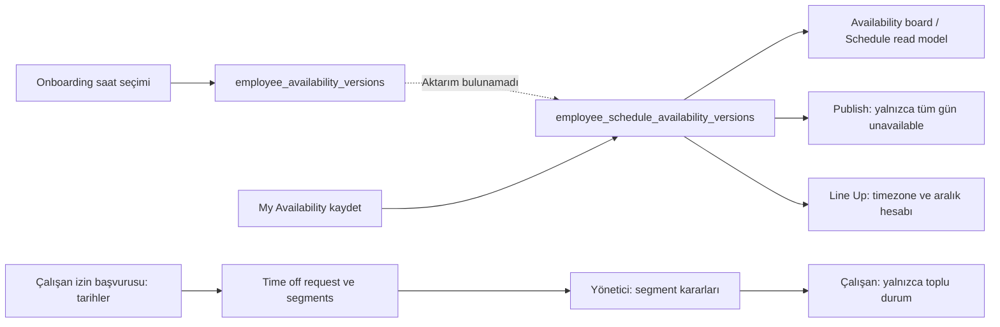
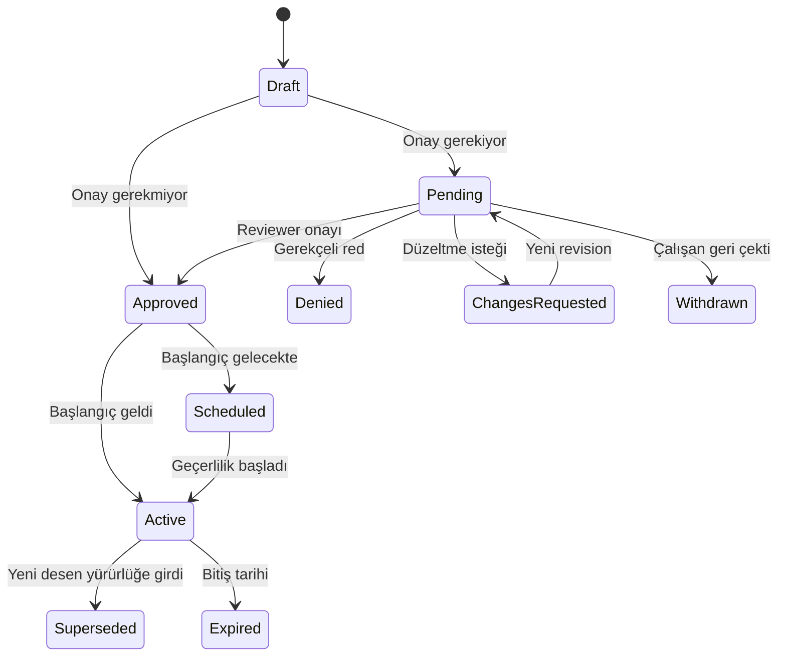

# Availability: uçtan uca audit, araştırma ve ürün değerlendirmesi

Tarih: 7 Eylül 2026, America/Los_Angeles.

Durum: **Araştırma ve karar zemini. Implementation planı değildir.** Ürün kodu, ayarlar, çalışan kayıtları veya migration'lar değiştirilmedi.

**Sonraki kullanıcı kararıyla güncellendi:** Availability yayın öncesi planlama girdisidir. Yayınlanmış dönem availability değişikliğine kapalıdır; çalışan bu yolla vardiya sorumluluğundan çıkamaz. Yayın sonrası izin/coverage/swap başvurusu da gerekli yetkili karar ve açık assignment değişikliği tamamlanmadan sorumluluğu kaldırmaz. Ayrıntılı yayın kilidi ve güncellenen uygulama planı bağlantılı v2 dokümanındadır.

**İkinci değerlendirme:** Saat / isim / isim+saat vardiya modelleri ve employee/manager sahipliği için [v2 ürün sözleşmesi ve uygulama planı](availability-shift-model-and-implementation-plan-v2-2026-09-07.md) hazırlandı. Aşağıdaki ilk audit kanıtları korunur; tasarım seçeneklerinin güncel önerisi ve uygulama sırası v2 dokümanındadır. Özellikle yalnız isimle girilen vardiyanın shift-type default saatlerinden değerlendirilmesi v2'de açıkça tanımlanmıştır.

## 1. Sonuç ve kanıt sınırı

Availability'nin bazı parçaları mevcut; ancak onboarding, çalışan self-service, yönetici drawer'ı, Schedule, yayınlama ve vardiya değişimi aynı ürün sözleşmesini uygulamıyor. En büyük sorun, sadece saat seçicinin sınırlılığı değil, çalışanın bildirdiği müsaitliğin hangi kayda yazıldığı ve hangi karar anında dikkate alındığının parçalanmış olması.

En kritik sonuçlar:

1. Onboarding ve Schedule availability'si iki ayrı tabloda. İncelenen uygulama kodunda, migration'larda ve yerel DB fonksiyon/trigger tanımlarında onboarding'den Schedule'a aktarım bulunamadı.
2. Settings'teki `availability_enforcement=hard` availability değerlendiren akışlara bağlanmamış. Bazı UI yolları availability'yi engel sayarken Quick Editor ve yayın öncesi kontrol soft davranıyor.
3. Çalışan self-service ekranı özel saat editörü sunmuyor; `Any time / Unavailable / 09:00–17:00` seçiyor. Mevcut özel saatleri yanlış etiketleyebiliyor.
4. Availability için gerçek bir pending/approve/deny/effective yaşam döngüsü yok. Kaydetme hemen yeni geçerli sürüm oluşturuyor.
5. Kısmi izin kararı yönetici tarafında segmentlere yazılıyor; çalışana yalnızca toplu durum ve kendi notu dönüyor. Hangi günün onaylandığı görünmüyor.
6. Gece yarısı, saat dilimi, gün içi izin, vardiya takası ve yayınlama arasında eksikler var. Aynı atama bir ekranda engellenip başka yoldan kaçabiliyor.

### İncelenen ortam

- Checkout: `C:\Users\TheWe\Documents\Codex\newfork-clean`.
- Branch/HEAD: `codex/phase-1-foundation`, `415b15f`; çok sayıda mevcut değişiklik ve paralel worktree var. Bulgular commit'e değil, inceleme anındaki çalışma ağacına aittir.
- Web/API: 5555/5556; listener ve süreç yolları bu checkout ile eşleştirildi, süreçlere müdahale edilmedi.
- DB: `supabase_db_newfork-clean`; sadece `BEGIN READ ONLY` sorguları çalıştırıldı.
- Browser: mevcut yönetici yüzeyine erişebilen oturumla Availability board ve Employee drawer incelendi. Employee Hub adresi bu oturumda Workspace'e yönlendi; employee rolünde onboarding/self-service görsel UAT yapılmadı.
- Odaklı test: 7 web dosyasında 46, 3 API dosyasında 16 test geçti. Toplam **62**.
- İlave kanıt: mevcut şemalara ve conflict fonksiyonuna karşı geçici TypeScript probe; salt okunur SQL karşı örnekleri.
- Hosted ortam, gerçek bildirim teslimatı, tam DB test paketi, eşzamanlı gerçek yazma ve tüm mobil/klavye akışları bu audit'te doğrulanmadı.

Yerel DB'de onboarding availability satırı sayısı sıfırdı. Bu nedenle aktarım eksikliği, bu oturumda veri kaybı yaşandığı iddiası değildir; yazan/okuyan yolların ve trigger'ların bağlantısızlığının doğrulanmasıdır. Eski Newfork notları yalnızca araştırma yönünü belirlemek için kullanıldı; eski mimari mevcut ürün davranışı kabul edilmedi.

## 2. Bugünkü akış haritası

| Yüzey | Gerçek davranış | Eksik bağlantı |
|---|---|---|
| Organization / Scheduling Settings | Haftanın başlangıcı, genel conflict policy ve soft/hard availability ayarı | Availability approval, effective date, notice, exception ve override yetki sözleşmesi yok; enforcement ayarı tüketilmiyor |
| Employee onboarding | Yedi günlük durum; günde tek görünen özel saat çifti | Opsiyonel adım; tüm günler önceden açık; Schedule'a aktarım yok |
| My Availability | Haftalık seçim, aynı sayfada izin formu ve izin geçmişi | Serbest saat, çoklu aralık, geçerlilik tarihi, onay/red ve değişiklik karşılaştırması yok |
| Employee drawer / Availability | Onboarding requirement durum paneli | Çalışanın gerçek haftası, self-service sürümleri, tarihçe ve manager edit yok |
| Team Availability board | Çalışan/hafta kartları, missing sayısı, basit conflict sayımı | Karar/editleme/detaya geçiş, pending görünümü ve zaman bağlamı yok |
| Schedule Quick Editor | Availability uyarısında `Add/Save anyway` mümkün | Hard ayarı uygulanmıyor; gerekçe sabit metin |
| Drag/drop, paste, employee picker | Availability conflict varsa engelleme/aday eleme | Soft durumda yönetici istisnasına tutarlı geçiş yok |
| Draft availability taraması | Saat penceresi ve tüm gün kapalı kontrolü | Gece yarısı hesabı ve sürüm tarihi seçimi sorunlu |
| Publish preflight | Tüm gün unavailable için sabit soft finding | Saat penceresi ve onaylı izin kontrolü yok |
| Auto-fill | Availability aralık kontrolüyle aday eliyor | Basit saat karşılaştırması; approval/policy ayrımı yok |
| Shift pickup/swap | Bazı overlap, izin, lokasyon ve participant kontrolleri | Recurring availability okunmuyor; takasın iki yönüne simetrik kontrol eksik |
| Line Up | Zaman dilimi ve interval union kullanan daha gelişmiş uygunluk kontrolü | Schedule ile aynı policy'yi paylaşmıyor; eksik availability burada verification required |
| Time off manager | Approve, deny, partial, return to pending, revoke; revision ve event kaydı | Çalışan detayları, saat bazında başvuru ve karar sonrası coverage yönetimi eksik |



## 3. Öncelikli bulgular

P0: çalışanın bildirimine/kararına güveni veya planlama doğruluğunu doğrudan bozan eksik. P1: günlük operasyonu sınırlayan işlev/deneyim açığı. Bunlar release sertifikasyonu değil, bu konuya ait ürün öncelikleridir.

### A01 — P0: Onboarding müsaitliği Schedule'a bağlanmıyor

`save_employee_availability_service` yalnızca `employee_availability_versions` tablosuna yazar. Employee Hub, board ve Schedule `employee_schedule_availability_versions` okur. API servisinde de aktarım yok. Yerel DB'de iki tablo üzerinde aktarım yapan kullanıcı trigger'ı bulunmuyor.

**Sonuç:** Çalışan onboarding'de müsaitliğini bildirmiş olsa bile planlayıcı aynı bilgiyi bulamayabilir. İki kayıt deposunu saklamak tek başına yanlış değildir; eksik olan ortak geçerli kayıt ve kaynak bağlantısıdır.

Kanıt: `supabase/migrations/20260818170000_employee_onboarding.sql:648`, `20260818190000_schedule_read_model.sql:5`, `20260822100000_employee_hub.sql:127`; `apps/api/src/employees/onboarding-service.ts:132`. Yerel DB fonksiyon ve trigger incelemesiyle doğrulandı.

### A02 — P0: Soft/hard ayarı davranışı belirlemiyor

Settings açıklaması Hard için unavailable assignment engelleme sözü veriyor. Buna karşın availability tüketen fonksiyonlarda `availability_enforcement` referansı yok. Publish fonksiyonlarında finding sabit `soft, true`. Quick Editor hard reason listesine availability dahil değil. Drag/drop ve paste ise tüm conflict'leri engelliyor; employee picker availability sebebiyle adayı eliyor.

**Örnek:** Cuma kapalı olan çalışanı Quick Editor ile uyarıyı geçerek atamak mümkünken aynı atamanın drag/drop yolu engellenebilir. Organization ayarı bu farkı çözmüyor.

Kanıt: `SchedulingSettingsPage.tsx:195`, `ShiftQuickEditor.tsx:350,865,892`, `useScheduleGridDragControllers.ts:64`, `shiftEditorEligibility.ts:61`, `SchedulePage.tsx:1821`; `20260907113000_schedule_publish_notifications.sql:185`. Repo taraması ve yerel DB tanımlarıyla doğrulandı; gerçek atama yapılmadı.

### A03 — P0: Publish kontrolü saat pencerelerini ve izinleri kapsamıyor

Mevcut publish availability branch'i yalnızca `mode='unavailable'` arar. `windows` yok. Yerel DB'deki iki publish preview overload'ında time-off okuması da yok. Frontend'de saat kontrolünün bulunması sunucu yayınlama güvencesi sağlamıyor.

**Örnek:** Çalışan Pazartesi 09:00–12:00 müsait; 16:00–20:00 vardiyası availability saat penceresi nedeniyle publish bulgusu üretmeyebilir. Onaylı izinle aynı güne vardiya yazılması da aynı kontrol zincirinde değerlendirilmelidir.

Kanıt: `20260907113000_schedule_publish_notifications.sql:174`; yerel `preview_schedule_publication_service` tanımları. Belge süresi gibi diğer yayın wrapper'ları bu availability/izin boşluğunu kapatan ortak kontrol sunmuyor.

### A04 — P0: Gece yarısı ve timezone semantiği parçalanmış

Board, draft taraması ve auto-fill bazı kontrollerde salt saatleri karşılaştırıyor. `09:00 <= 22:00 AND 17:00 >= 02:00` doğru çıkar; oysa 22:00–ertesi gün 02:00 vardiyası 09:00–17:00 penceresine sığmaz. Frontend'in daha iyi interval hesabı da başlangıç gününün kuralına bakıyor: Pazartesi açık, Salı kapalı iken Pazartesi 22:00–Salı 02:00 probe'u conflict üretmedi.

Onboarding timezone'u cihazdan alır; self-service kaydında mevcut kayıt timezone'u yerine yine cihaz timezone'u yazılır. Schedule read model'de recurring rules taşınırken timezone taşınmaz. Seyahatteki çalışan farkında olmadan kuralın zaman referansını değiştirebilir. Line Up ise timezone ile gerçek aralığa dönüştürür.

Kanıt: `AvailabilityPage.tsx:300`, `schedule-conflicts.ts` içindeki availability seçimi ve `clockInterval`; `20260907103000_schedule_draft_availability_conflicts.sql:112`, `20260819150000_schedule_templates_autofill_export.sql:272`, `EmployeeHubPage.tsx:474`, `EmployeeOnboardingPage.tsx:891`, `20260908104000_schedule_rpc_shift_fields_forward_fix.sql:155`. TypeScript ve salt okunur SQL karşı örnekleriyle doğrulandı.

### A05 — P0: Availability onay/red yaşam döngüsü yok

Hub save doğrudan yeni sürüm ekler; `effective_at` varsayılanı `now()`. Pending talep, reviewer, reddetme nedeni, withdrawal, yürürlük tarihi ve onay beklerken eski sürümü koruma sözleşmesi yok. Onboarding availability requirement'ı son migration'da optional, non-blocking ve review'suz; save işlemi doğrudan completed yapar.

**Sonuç:** Onboarding accept/reject UI'sının genel olarak bulunması, availability değişikliklerinin onaylandığı anlamına gelmez. “Kaydedildi”, “onaylandı” ve “yürürlükte” bugün ayrılmıyor.

Kanıt: `20260822100000_employee_hub.sql:163`, `20260818190000_schedule_read_model.sql:13`, `20260908142000_employee_onboarding_defer_ssn_v1.sql:45`, `20260818170000_employee_onboarding.sql:686`.

### A06 — P0: Kısmi izin kararının çalışan karşılığı eksik

Manager API segment ve event ayrıntısı taşırken Hub request nesnesi yalnızca title/detail/status/revision içeriyor. Detail çalışanın kendi reason'ı. Hangi gün onaylandı, hangi gün reddedildi, kim karar verdi, manager notu ve etkilenen vardiya çalışana dönmüyor.

**Örnek:** 10–12 Eylül için 10 ve 12 onaylanıp 11 reddedildiğinde çalışan sadece “Partially approved” görür; hangi gün işe gelmesi beklendiğini bu ekrandan öğrenemez.

Kanıt: `20260822100000_employee_hub.sql:96`, `packages/shared/src/employee-hub.ts` içindeki `employeeHubRequestSchema`, `EmployeeHubPage.tsx:614`; karşı taraf: `20260821100000_schedule_requests.sql:168`.

### A07 — P1: Serbest saat ve çoklu aralık UX'i tutarsız

Onboarding UI yalnızca ilk pencereyi gösterir; saat alanı düzenlenince windows dizisini tek elemanla değiştirir. Şema dört pencereyi kabul eder ama UI ekleme/silme sunmaz. Hub'da saat girişi yok; windows seçeneği sabit 09:00–17:00.

**Örnek:** Kayıtta 10:30–15:00 varsa Hub select'i yine 09:00–17:00 etiketi gösterir. Kullanıcı başka moda geçip windows'a dönünce gerçek değer 09:00–17:00'a dönüşür. Birden çok pencerenin onboarding'de düzenlenmesi diğerlerini silebilir.

Kanıt: `EmployeeOnboardingPage.tsx:615`, `EmployeeHubPage.tsx:511`. Daypart/shift-type bazında kullanıcı availability seçimi mevcut UI/API modelinde yok; çalışan shift-type assignment'ı ayrı bir eligibility kavramı.

### A08 — P1: Drawer, gerçek availability yerine onboarding durumu gösteriyor

Availability sekmesi `OnboardingReviewPanel` kullanıyor; gün/saat, geçerli sürüm, employee update veya manager edit sunmuyor.

**Browser'da doğrulanan örnek:** Availability board'da Cuma unavailable kaydı görülen aynı çalışanın drawer sekmesi “Onboarding not started” gösterdi. Böylece kayıt mevcutken yönetici availability içeriğini drawer'dan göremiyor.

Kanıt: `EmployeeDrawer.tsx:889,935`. Bu örnek mevcut yönetici yüzeyinde DOM ve screenshot ile doğrulandı.

### A09 — P0: Pickup/swap aynı availability kurallarına tabi değil

`get_shift_change_conflicts_service` recurring availability tablosunu okumuyor. Onaylı izin kontrolü alıcı ve offered shift'in aynı tarihine bakıyor; saat aralığı/ertesi gün ayrımı yok. Direct swap'ta her iki kişinin alacağı yeni vardiya için simetrik recurring availability kontrolü bulunmuyor.

**Sonuç:** Normal planlayıcıdan geçmeyen atama, shift change kanalında farklı değerlendirilebilir. Employee'nin pickup istemesi haftalık availability'sini sessizce değiştirmemelidir; tek vardiyalık gönüllü istisna ayrı tutulmalıdır.

Kanıt: `20260822100000_employee_hub.sql:254`; yerel DB fonksiyon tanımı.

### A10 — P1: Şema ve DB validation aynı sözleşmeyi uygulamıyor

Probe sonuçları:

| Payload | Onboarding şeması | Hub şeması |
|---|---|---|
| windows, boş dizi | Reddeder | Kabul eder |
| 17:00–09:00 | Reddeder | Kabul eder |
| 09:00–09:00 | Reddeder | Kabul eder |
| 09:00–13:00 ve 12:00–17:00 | Kabul eder | Kabul eder |
| Geçersiz timezone adı | IANA doğrulaması yok | Kabul eder |

Hub SQL temel dizi/weekday kontrolünden fazlasını yapmıyor. Gece vardiyası desteği için ters saatleri gelişigüzel kabul etmek yeterli değildir; açık ertesi-gün semantiği gerekir. Overlap union ile normalize edilecekse bunun da açık sözleşmesi olmalı.

Kanıt: `packages/shared/src/index.ts:2461`, `packages/shared/src/employee-hub.ts:5`, `20260822100000_employee_hub.sql:169`. Probe mevcut export'ları doğrudan çalıştırdı; ürün verisine yazmadı.

### A11 — P1: Sürüm var, eşzamanlı değişiklik koruması yok

Hub save `max(version_number)+1` kullanır; expected base version almaz, çalışan satırı kilidi yoktur. Ardışık stale form kaydı eski bilgiyi yeni sürüm olarak tekrar geçerli yapabilir. Gerçek eşzamanlı iki kayıt unique constraint hatasına düşebilir. Immutable satır tutmak tek başına stale overwrite'i önlemez.

Hub UI `useState(initial)` ile açılır; yeni sunucu availability'sini temiz forma eşitleyen effect veya remote-update bildirimi yok. Dakikalık refetch olduğunda form eski kalabilir. Bu, doğrulanmış refetch kaynaklı draft silinmesi iddiası değildir; burada risk stale görünüm ve stale save'dir.

Kanıt: `20260822100000_employee_hub.sql:174`, `EmployeeHubPage.tsx:456`. Yarış gerçek yazmayla koşturulmadı; koddan çıkarım.

### A12 — P0: Kısmi kararda duplicate segment validation açığı

API `segment_decisions` içinde aynı segment ID'sinin tekrarını yasaklamıyor. SQL tüm pending segmentler kapsandı mı sorusunu distinct kimliklerle değil join satır sayısıyla doğruluyor.

**Karşı örnek:** Pending A ve B varken `[A=approved, A=approved]` iki karar sayılıyor; B kararsız kalabilir, request aggregate approved olabilir. Schema probe duplicate'i kabul etti. Salt okunur CTE, iki kararın yalnızca bir benzersiz segmenti kapsadığı halde count kontrolüne uyduğunu doğruladı. Gerçek resolver çağrısıyla mutation yapılmadı.

Kanıt: `packages/shared/src/index.ts:1932`, `20260821100000_schedule_requests.sql:202`.

### A13 — P1: “Kısmi izin” şu an yalnızca tarihler arasında karar

DB segmentlerinde start/end alanları var; çalışan başvurusu yalnızca `dates[]` alır ve tam gün segment oluşturur. Manager partial dialog yalnızca tarih + approve/deny gösterir; saat aralığını bölemez. Tüm satırlar varsayılan approved başlar, yanlışlıkla tümünü onaylamak kolaydır. Red/partial için not zorunlu değil.

Bir talebin bazı günlerini kabul etmek ile bir günün 13:00–16:00 bölümünü kabul etmek farklı gereksinimlerdir; ikisi de tasarımda açık tanımlanmalıdır.

Kanıt: `EmployeeHubPage.tsx:480`, `20260822100000_employee_hub.sql:180`, `ScheduleRequestsPage.tsx:759,794`.

### A14 — P1: İzin sonrası operasyon ve yeniden başvuru eksikleri

Onay işlemi segment ve request durumunu değiştirir; mevcut vardiya/coverage çözümünü gerçekleştirmez. Çalışan sadece pending talebi iptal edebilir. Önceden onaylanmış izni kaldırma isteği için net self-service akış yok. Bir partial talebin reddedilmiş günü için yeniden başvuru da overlap kontrolünde request'in genel durumu nedeniyle engellenebilir; kontrol segment.status filtrelemiyor. `return_to_pending` tüm segmentleri pending yapar; notification producer bu event'i özellikle atlar.

Kanıt: `20260821100000_schedule_requests.sql:199`, `20260822100000_employee_hub.sql:188,232`, `20260908121000_notification_request_producers_v1.sql:113`. Vardiya bırakma ile izin onayı ayrı karar olarak görünmelidir.

### A15 — P1: Başlangıç/bitiş tarihi ve geçmiş yorumlama yok

Sürüm tablosunda effective_at var ancak employee request'te kullanıcı kontrollü effective date/end date yok. Bazı okuyucular `effective_at<=now()`, bazıları sadece max version, Line Up ise shift başlangıcı kullanıyor. Geçmiş veya gelecek haftanın board'u bugünkü kurallarla yorumlanabilir. Saat aralığı ve timezone bilgisi değişince eski publish override'ın geçerliliği de yeniden değerlendirilmeli.

Kanıt: `20260822100000_employee_hub.sql:130`, `20260908104000_schedule_rpc_shift_fields_forward_fix.sql:155`, `20260907113000_schedule_publish_notifications.sql:194`, `20260909000000_lineup_operations_v1.sql:191`.

### A16 — P1: Eksik veri ve gerçek açıklık karıştırılıyor

Onboarding ve Hub varsayılan tüm günleri unrestricted gösterir. Board eksik kaydı Missing diye ayırsa da aynı kartta “No scheduled conflicts” gösterebilir. Schedule evaluator eksik availability'yi engellemez; Line Up verification required üretir. `available`, `unknown` ve `confirmed unrestricted` ayrı olmalıdır.

Board hafta sırası sabit Sunday–Saturday; organization week-start ayarını takip etmiyor. Saatler 24h biçiminde ham gösteriliyor. Görsel incelemede bazı gün etiketleri dar hücrede kısalıyordu. Board'dan drawer'a veya düzeltme/karar yüzeyine doğrudan aksiyon bulunmuyor.

Kanıt: `EmployeeOnboardingPage.tsx:891`, `EmployeeHubPage.tsx:456`, `AvailabilityPage.tsx`; browser board.

### A17 — P1: Override, employee edit ve acknowledgement karıştırılmaya açık

Shift Quick Editor sabit “Manager acknowledged schedule warning.” metniyle override kaydı üretiyor. Bu, manager'ın gerçek gerekçesi veya employee'nin kabulü değildir. Availability sürümünün `recorded_by/source` alanları yararlı, fakat önceki-sonraki diff, karar, etkilenen vardiya ve employee acknowledgement ekranı yok.

Kanıt: `ShiftQuickEditor.tsx:46,865`, `20260908196000_schedule_soft_conflict_override_audit.sql:38`. Bildirim katalog/producer incelemesinde availability change yaşam döngüsüne bağlı aktif üretici bulunmadı; time off bildirim altyapısı mevcut.

## 4. Dış ürün araştırmasının gösterdiği seçenekler

Bu karşılaştırma resmî ürün yardım kaynaklarına dayanır; rakiplerde uygulamalı hesap testi yapılmadı. Aşağıdaki Newfork önerileri kaynaklardan yapılan ürün çıkarımlarıdır.

| Ürün | Belgelenmiş yaklaşım | Newfork için çıkarım |
|---|---|---|
| 7shifts | Organization düzeyinde availability approval, geçici müsaitlik, yayınlanmış hafta için değişiklik izni ve çalışan erişimi ayarları | Approval ve yürürlük ayrılabilir; Newfork'ta kullanıcı kararı gereği yayınlanmış dönem kilidi kapatılamaz |
| 7shifts | Pending başvuru, manager approve/decline, çalışana sonuç ve durum görünürlüğü | Çalışan kaydettikten sonra tam olarak ne beklediğini görmeli |
| Deputy | Availability/unavailability onaysız; manager warning ile shift atayabilir. Kısmi available girişi günün geri kalanını unavailable yapar | Onaysız model geçerli bir ürün tercihi; anlamı ve override sonucu açık olmalı |
| When I Work | Availability ve izin Schedule üzerinde ayrı yorumlanır; preferred saatlere tam/kısmi uyan template'ler ayrılır | “Çalışabilirim”, “tercih ederim” ve “izinliyim” tek statü olmamalı |

Kaynaklar, 7 Eylül 2026'da incelendi:

- [7shifts — Availability Company Settings](https://kb.7shifts.com/hc/en-us/articles/33770703246099-Availability-Company-Settings)
- [7shifts — Approve Availability Requests](https://kb.7shifts.com/hc/en-us/articles/4417519789587-Approve-Availability-Requests)
- [7shifts — Submit Your Availability](https://kb.7shifts.com/hc/en-us/articles/4417514175251-Submit-Your-Availability)
- [Deputy — Add, update or delete availability and unavailability](https://help.deputy.com/hc/en-au/articles/4658282900111-Add-update-or-delete-your-team-member-s-availability-and-unavailability)
- [When I Work — Interpreting Availability and Time Off While Scheduling](https://help.wheniwork.net/articles/interpreting-availability-on-the-schedule-computer/)

## 5. Önerilen ürün anlamları

| Kavram | Anlam | Schedule etkisi |
|---|---|---|
| Bildirilmemiş | Çalışan henüz teyit etmedi | Unknown; açık çalışabilirlik sayılmaz |
| Müsait | Bu aralıkta çalışabilir | Diğer eligibility/izin kontrollerinden sonra aday |
| Tercih edilen | Çalışabileceği saatler içinde tercih | Sıralama sinyali; tek başına engel değil |
| Müsait değil | Çalışamayacağını bildirdiği aralık | Yürürlükteki organization soft/hard politikası |
| Tarihli availability istisnası | Tek gün veya dönem için farklı kapasite | Belirli tarihlerde haftalık desenin yerini alır |
| Time off | Belirli tarih/aralık için izin talebi ve kararı | Yalnızca onaylı segmentler izin engeli oluşturur |
| Tek vardiyalık override | Belirli atama için yönetici istisnası | Haftalık availability'yi değiştirmez |
| Manager availability edit | Çalışanın deseni üzerinde yetkili düzeltme | Yeni sürüm + kaynak + gerekçe + employee görünürlüğü |
| Employee acknowledgement | Değişikliği gördüğünün teyidi | Çalışmayı kabul etmekten ve talep onayından ayrıdır |

**Yayın öncesi ürün önerisi:** Açık döneme zamanında yapılmış availability talebini reddetmek, çalışanın gerçekten çalışabileceğini kanıtlamaz. Eski kabul edilmiş desen yürürlükte kalabilir; ancak çözümlenmemiş kapasite bildirimi planlayıcıda görünür ve ilgili yayın öncesinde çözülür. Bu mekanizma yayın sonrası availability başvurusu kabul etmek veya mevcut vardiya sorumluluğunu kaldırmak için kullanılamaz.

## 6. Gün, saat, daypart ve shift type birlikte nasıl çalışmalı?

Önerim: **saat aralıkları temel gerçek; daypart hızlı giriş; shift type ise ayrı anlamsal kural.**

- Gün: Tek gün, çoklu gün, hafta içi/hafta sonu ve tüm hafta seçimi. Aynı gün birden fazla çalışma aralığı.
- Saat: Serbest başlangıç/bitiş girişi; saat seçici ve doğrudan klavye kullanımı. Örneğin 08:15–11:45 + 16:30–22:10. Ürün keyfî bir 09–17 veya 15/30 dakika ızgarasına zorlamamalı.
- Gece: `22:00 → 02:00 (+1 gün)` açık gösterilir. Eşit başlangıç/bitiş 24 saat anlamına otomatik gelmez; ayrı “Tüm gün” seçeneği vardır.
- Daypart: Örneğin Brunch/Lunch/Dinner. Seçildiğinde o lokasyon için gerçek saat karşılığı görünür. Daypart saatinin sonradan değişmesi çalışanın teyit ettiği saatleri sessizce genişletmemeli. Varsayılan öneri: seçildiği andaki saat aralığını saklamak; yeni daypart saatine geçiş için değişiklik bildirimi/yeniden teyit.
- Shift type: “Cumartesi Closing istemiyorum/uygun değilim” gibi belirli vardiya türü kuralı. Seçim ilgili türün saatleri varsa onları gösterir; saatsiz türlerde fiziksel uygunluk kesinmiş gibi davranılmaz.
- Eligibility: Bir vardiya türünü yapmaya yetkili olmak, o vardiyaya müsait olmak demek değildir. İş/pozisyon/lokasyon yetkinliği manager-owned assignment olarak ayrı kalır.
- Özel saat ile shift-type kuralı çakışırsa açıklanabilir sonuç üretilir: “Saatler uygun; Closing kuralı nedeniyle uygun değil.” Tercih işareti sert engeli kaldırmaz.
- Daypart isimleri benzer olsa bile farklı lokasyonların farklı saatleri tek isim altında birleştirilmez.

**Aralık mantığı:** Yürürlükteki weekly desen → tarihli exception → onaylı izin düşümü → mevcut vardiya/seyahat/eligibility kontrolü. Tercih yalnızca kalan uygun aralıkları sıralar. Bir vardiyanın başlangıcının uygun olması yetmez; bütün süresi uygun aralıkların birleşimi içinde kalmalıdır.

## 7. Çalışan deneyimi önerisi

### Onboarding

1. “Normalde hangi gün ve saatlerde çalışabilirsin?”; çalışma lokasyonu ve zaman dilimi belirgin.
2. Yedi gün için henüz seçilmemiş durum, “Her gün müsaitim” açık toplu seçim, gün seçip kopyalama.
3. Günde çoklu aralık ve daypart kısayolu; gelişmiş alanda shift-type tercih/kısıtı.
4. Özet: “Pzt 09:00–13:00 ve 17:00–22:00; Salı müsait değil; …”. Başlangıç tarihi açık.
5. Organization onayı gerekiyorsa “İncelemeye gönder”; gerekmiyorsa “Müsaitliğimi kaydet”. Onboarding tamamlanması ile availability review ayrı durumlar.
6. Adım opsiyonelse “Şimdi atla” sonrası durum “Henüz bildirilmedi”; sistem bunu sınırsız müsaitliğe dönüştürmez. Mevcut optional kararını değiştirmek ayrı ürün kararıdır.

### Uygulama içi My Availability

Üstte **Yürürlükte / Bekleyen değişiklik / Gelecek / Geçmiş**. Editör açılmadan önce güncel hafta okunabilir olmalı. Ana aksiyon “Değişiklik bildir”; alt aksiyon “Belirli tarih için istisna”. Time off bu sayfadan kolay erişilir ama ayrı başlık ve ayrı yaşam döngüsüyle gösterilir.

Kaydetmeden önce: önce/sonra diff, geçerli olacağı açık dönemler, timezone, kapsam dışında kalan yayınlanmış dönemler ve onay politikası gösterilir. Yayınlanmış döneme availability kaydı kabul edilmez; çalışan izin/shift-change yoluna yönlendirilir. “Bu vardiya hâlâ sana atanmış” bilgisi assignment durumuyla tutarlı gösterilir.

Kaydetme sonucu açık: “Talep alındı, mevcut müsaitliğin 14 Eylül'e kadar devam ediyor” veya “14 Eylül'den itibaren yürürlükte”. Yalnızca butonun kapanması yeterli değildir.

Pending sırasında çalışan talebi geri çekebilir veya yerine yeni başvuru oluşturabilir; eski başvuru superseded olarak kalır. Red mesajında gerekçe, mevcut geçerli desen ve yeniden başvuru aksiyonu görünür. Manager kendi desenini değiştirdiyse “Yönetici tarafından değiştirildi” etiketi ve diff görünür.

### Kısmi izin ayrıntısı

Örnek employee görünümü:

| Tarih / istenen aralık | Karar | Açıklama |
|---|---|---|
| 10 Eylül, tüm gün | Onaylandı | İzinli |
| 11 Eylül, 09:00–17:00 | 09:00–13:00 onaylandı; 13:00–17:00 reddedildi | Manager notu görünür |
| 12 Eylül, tüm gün | Onaylandı | İzinli |

Bu öneri mevcut UI'da uygulanmış değildir. Saat bazlı partial karar, istenen aralığı kapsayan ve birbirini örtmeyen karar parçalarıyla ifade edilmelidir; talep edilen saatler tarihçe olarak korunur. “Reddedildi” bölümü otomatik atanmış vardiya anlamına gelmez; varsa ilgili yayınlanmış vardiya ayrıca görünür.

### Mobil, klavye ve hata davranışı

- Desktop'ta haftalık grid; mobilde aynı anlamı koruyan gün kartları ve sabit özet/kaydet alanı.
- 320/390 px, büyük yazı, 12h/24h, organization week-start ve uzun daypart etiketleri kapsanmalı.
- Native time alanı veya erişilebilir karşılığı; gün/aralık bazında açık label, hata metni, focus yönetimi. Renk tek başına karar taşımaz.
- Sayfadan ayrılırken dirty uyarısı; temiz form sunucudan güncellenebilir, kirli forma gelen remote değişiklik banner'ı çıkar. “Eski sürüm; karşılaştırıp yeniden gönder” kurtarma yolu.
- Network timeout'ta tekrar submit aynı talebi çoğaltmaz. Başarı doğrulanmadan editör temizlenmez.

## 8. Yönetici deneyimi önerisi

### Requests

Mevcut Schedule → Requests altında **Availability / Time off / Shift changes** ayrımı. Availability board ayrı kapasite inceleme yüzeyi olarak kalabilir; sidebar hiyerarşisini bu audit tek başına değiştirmeyi önermez.

Talep satırı: çalışan, lokasyon kapsamı, istenen başlangıç, değişen günler, bekleme süresi, published-shift etkisi ve durum. Filtreler: Needs review / Upcoming / History; konum ve çalışan.

Detay: solda mevcut desen, sağda öneri; etkilenen vardiyalar ve coverage. Aksiyonlar: Onayla, gerekçeyle reddet, değişiklik iste. Talebin employee/manager tarafında aynı request kimliği ve revision ile gösterilmesi gerekir.

Availability deseni için otomatik “partial approve” yerine ilk tercih **değişiklik öner / yeniden teyit iste** olmalı. Haftanın yarısını sessizce kabul etmek çalışanın niyetini değiştirebilir. Saat bazlı partial karar esas olarak Time off içinde açık segment modeliyle ele alınmalı.

### Employee drawer / Availability

Sıra: güncel desen ve timezone → bekleyen/gelecek değişiklik → tarihli istisnalar/izinler → kaynak ve tarihçe. Yönetici izinliyse “Çalışan adına düzenle”; gün-saat diff'i ve gerekçe zorunlu. Onboarding tamamlandı rozeti yardımcı meta bilgidir; ana içerik değildir.

Onboarding başlamamış ama elle oluşturulmuş çalışanın availability'si de burada yönetilebilir. Onboarding olmayan kaydı boş panelle saklamak doğru değil.

### Schedule / atama

Çalışan adayları “uygun / tercih edilen / kısmen uygun / doğrulama gerekiyor / uygun değil” gerekçeleriyle görünmeli. Soft conflict'li adayı tamamen gizlemek yerine uyarı ile inceleme mümkün olmalı. Hard conflict'in hangi aralıkta olduğu ve hangi eylemin çözeceği belirtilmeli.

Override iki ayrı işlem:

1. **Bu vardiya için istisna:** çalışan deseni aynı kalır; vardiya + kural sürümü + gerçek gerekçe + actor + timestamp kaydı oluşur. Gerekirse employee kabulü ayrıca istenir.
2. **Availability'yi değiştir:** yeni geçerli desen önerir/oluşturur; kapsamlı değişikliktir, aynı butonun yan etkisi olmamalı.

Onaylanmış izin ve gerçek zaman çakışması için genel “Add anyway” önerilmez. İzni değiştirme veya vardiya yeniden düzenleme akışına yönlendirilir. Hard availability'nin istisnası istenecekse ayrıca yetkili ve tanımlı süreç gerekir; Hard'ın anlamı gizli genel bypass olmamalı.

## 9. Organization settings karar çerçevesi

Aşağıdakiler önerilen ayarlardır; mevcut implementation listesi değildir. Günlük kullanım için sade varsayılanlar, gelişmiş alanlarda ayrıntı önerilir.

| Ayar | Önerilen anlam / başlangıç yaklaşımı |
|---|---|
| Onboarding availability | Optional / required. Mevcut optional kararını açık karar alınmadan değiştirmeme |
| Çalışan kendi availability'sini değiştirebilir | Açık; kapalıysa çalışan geçerli kaydı ve manager değişikliklerini yine görür |
| Availability onayı | Yalnız yayınlanmamış kapsamda hiç / tüm değişiklikler / daraltan değişiklikler; varsayılan daraltan değişikliklerde review |
| Soft / hard enforcement | Onay gereksiniminden bağımsız. Aynı karar bütün assignment kanallarında uygulanır |
| Missing availability | “Doğrulama gerekiyor”; organization uyar/engelle davranışını seçebilir; “confirmed available” denmez |
| Geçerlilik tarihi | Başlangıç zorunlu; isteğe bağlı bitiş. Geçmişe dönük sessiz değişiklik yok |
| Ön bildirim süresi | Organization'ın seçtiği gün sayısı; süre aşılmış ama yayınlanmamış dönem için gerekçeli review yolu |
| Yayınlanmış dönem | Availability için kilitli; izin/shift-change ayrı süreçtir. Yetkili karar ve assignment değişikliği tamamlanana kadar sorumluluk sürer |
| Geçici desen ve tarihli exception | Açık; bitince hangi desene dönüleceği özetlenir |
| Daypart tanımları | Lokasyon ve saat aralığı; değişiklik etkisi ve arşivleme kuralları |
| Shift-type tercih/kısıtları | Yetkinlik atamasından ayrı; arşivlenen tür için eski kayıt anlamını koruma |
| Manager on-behalf edit / shift override | Ayrı izinler, kapsam, gerekçe ve çalışan bildirimi |
| Reviewer | Primary/home lokasyonun yetkili reviewer'ı; diğer etkilenen lokasyonlara görünürlük/escalation |
| Kendi başvurusunu onaylama | Varsayılan kapalı; manager aynı zamanda employee ise üst reviewer |
| Görünürlük | Manager gerekli müsaitliği görür; coworker'a özel neden/özel program paylaşılmaz |
| Saat dilimi ve gösterim | Kural timezone'u açık; 12h/24h yalnızca sunum; cihaz timezone'u sessizce değiştirmez |
| Bildirim ve hatırlatma | Availability lifecycle bildirimleri; yayın sonrası izin/assignment sonuçları kendi süreçlerinden bildirilir |

Organization ayarı değişirken bekleyen taleplerin eski/yeni politikadan hangisini kullanacağı gösterilmelidir. Öneri: talep ve karar anındaki policy revision tarihçede saklanır; commit anında güncel yetki ve gerçek conflict tekrar kontrol edilir. Yeni politika eski audit'i yeniden yazmaz.

## 10. Yaşam döngüsü ve precedence önerisi



Onay kararı ile yürürlük durumu ayrı boyutlar olarak ele alınmalıdır; diyagram kullanıcı akışını özetler. “Approved” her zaman bugün aktif demek değildir. Aynı kapsam/tarih için geçerli desen seçimi tek anlamlı olmalıdır. Geçici exception bittiğinde bugün için geçerli ana desene dönülür; eski bir snapshot kontrolsüz geri yüklenmez.

Değerlendirme sırası önerisi:

1. Workspace/employee erişimi, çalışma başlangıcı, arşiv/termination ve location/job/shift-type eligibility.
2. Gerçek vardiya zaman aralığı, timezone ve gece yarısı sınırları.
3. İlgili tarihte geçerli kabul edilmiş haftalık desen + tarihli exception.
4. Onaylı izin aralıkları ve yayınlanmış vardiyalar/seyahat süresi.
5. Pending/dismissed kapasite bildirimi gibi çözülmemiş operasyon uyarıları.
6. Organization enforcement ve yetkili override kararı.
7. Tercih bazında sıralama.

Publish/approve/assign commit anında yeniden kontrol gerekir: önizlemeden sonra yeni izin, availability veya başka vardiya gelmiş olabilir. Eski override yalnızca aynı employee, shift süresi, kural revision'ı ve kapsama aitse geçerli sayılır.

## 11. Edge-case ve kabul senaryosu kataloğu

Bu katalog bir test sonucu listesi değildir; implementation planından önce korunacak ürün beklentileridir.

| ID | Senaryo | Beklenen sonuç |
|---|---|---|
| E01 | Onboarding availability atlanır | Unknown; otomatik sınırsız çalışma yok |
| E02 | Her gün açık toplu seçilir | Açık employee teyidi kaydedilir |
| E03 | Her gün kapalı seçilir | Teyit/operasyon uyarısı; zorla açık güne dönüşmez |
| E04 | Onboarding'de girilir, Hub açılır | Aynı geçerli bilgi ve kaynak görünür |
| E05 | Onboarding başlamamış employee | Manager gerçek availability kaydını görebilir/düzenleyebilir |
| E06 | İkinci organization'a katılır | Ayrı desen ve timezone; başka org verisi taşınmaz |
| E07 | Günde iki ayrık aralık | Aradaki boşluk uygun sayılmaz |
| E08 | Bitişik iki aralık | Normalize edilmiş birleşim tam kapsamı doğru hesaplar |
| E09 | Aralıklar örtüşür | Normalize et veya açık validation; çifte kapasite yok |
| E10 | Ters/eşit saat | Ertesi gün açık değilse reddet; tüm gün ayrı seçim |
| E11 | Gece 22:00–02:00 | İki takvim gününün gerçek aralığı değerlendirilir |
| E12 | Haftanın sonundan ilk güne gece | Sunday=0 veri anlamı korunur; görsel sıra bağımsız |
| E13 | 23:59 ve 00:00 sınırı | Yapay bir dakikalık boşluk/çakışma oluşmaz |
| E14 | DST ileri/geri geçişi | Var olmayan/iki kez oluşan saat açık çözümlenir; frontend/backend aynı |
| E15 | Çalışan başka timezone'a seyahat eder | Görüntüleme/kural timezone'u ayrılır; save sessiz kaydırmaz |
| E16 | İki timezone'da lokasyon | Tüm atamalar gerçek anlara çevrilir, local tarih açık |
| E17 | Vardiya pencereden tam bitişte çıkar | Yarı açık aralık mantığıyla bitiş sınırı doğru |
| E18 | 1 dakika dışarı taşar | 1 dakika conflict görünür; dakika çözünürlüğü korunur |
| E19 | Daypart sonradan saat değiştirir | Geçmiş teyit sessiz değişmez; etki/yeniden teyit |
| E20 | Aynı daypart adı, farklı lokasyon | Saat ve lokasyon açık |
| E21 | Shift type arşivlenir | Geçmiş anlam korunur, yeni seçimden kalkar |
| E22 | Shift type saatsizdir | Saat uygunluğu bilinmiyor; doğrulama gerektiği görünür |
| E23 | Tür için eligible ama o gün kapalı | Eligibility müsaitlik engelini kaldırmaz |
| E24 | Yayın öncesi pending daraltma | Eski desen korunur; açık dönemde kapasite uyarısı görünür; ilgili yayın öncesinde çözülür |
| E25 | Pending genişletme | Auto-apply/review politikası tutarlı, sonuç görünür |
| E26 | Açık dönem talebi reddedilir | Gerekçe ve geçerli desen; çözümlenmemiş kapasite bildirimi yayın öncesinde ele alınır |
| E27 | Pending withdrawal | Aynı kimlik ve audit, eski geçerli desen değişmez |
| E28 | İkinci başvuru önceki pending'i değiştirir | Superseded/eski revision görünür; çifte aktif talep yok |
| E29 | İki manager aynı anda karar verir | Bir karar; diğeri stale state ile yenilemeye yönlenir |
| E30 | Employee save ile manager edit yarışır | Base revision kontrolü, sessiz overwrite yok |
| E31 | Manager kendi başvurusunu açar | Self-approval policy uygulanır |
| E32 | Reviewer lokasyon erişimini kaybeder | Karar anında yetki tekrar kontrol edilir |
| E33 | Birden fazla lokasyonu etkileyen başvuru | Tek karar sahibi, tüm etkilenen kapsamda görünür etki |
| E34 | Approval kapatılırken pending var | Açık dönüşüm politikası; sessiz toplu onay yok |
| E35 | Soft'tan Hard'a geçilir | Etkilenen vardiya önizlemesi; sonraki işlemler aynı policy |
| E36 | Effective date gelecekte | Bugünkü desen değişmez; gelecek vardiya doğru deseni kullanır |
| E37 | Geçici desenin bitişi | O tarihte geçerli ana desene deterministik dönüş |
| E38 | Geçmiş hafta incelenir | Tarihsel desen/karar bağlamı; bugünkü değişiklik geçmişi yeniden yazmaz |
| E39 | Yayınlanmış dönem için yeni availability denenir | Kilitli kapsam save'i reddedilir; izin/shift-change yolu gösterilir; sorumluluk sürer |
| E40 | İzin beklerken schedule yayınlanır | Pending izin uyarısı; final izin onayında assignment sonucu açık ve tutarlı çözülür |
| E41 | İzin onaylandıktan sonra shift yaratılır | Tüm creation/publish yollarında onaylı segment engeli |
| E42 | Partial request: bazı günler approved | Çalışan her günün kararını ve manager notunu görür |
| E43 | Aynı gün yalnızca 13:00–16:00 izin | 09:00–12:00 shift izinle conflict üretmez |
| E44 | Tek aralık saat bazında kısmi onay | İstenen aralık korunur; karar parçaları tam kapsar, örtüşmez |
| E45 | Duplicate/eksik/yabancı segment ID | Mutasyonun tamamı reddedilir |
| E46 | Reddedilmiş segment için tekrar başvuru | Genel partially_approved statüsü tek başına engellemez |
| E47 | Onaylı izin iptali istenir | İptal isteği ayrı; sonuçlanana kadar izin durumunun etkisi açık |
| E48 | İzin return-to-pending/revoke | Çalışana bildirim, Schedule etkisi ve tarihçe korunur |
| E49 | İzin isteği gece yarısını geçer | Komşu gün vardiyasıyla gerçek aralık çakışması |
| E50 | Gönüllü pickup haftalık kuralla çelişir | Tek vardiyalık willingness; genel desen değiştirilmez |
| E51 | Swap yalnızca bir tarafta uygun | Her iki yeni atama doğrulanır, işlem atomik kalır |
| E52 | Line Up partial candidate | Yalnızca uygun kısmı teklif; kısmi müsaitlik tam vardiya sayılmaz |
| E53 | Lokasyonlar arası move ve travel | Süre ve iki kapsam yetkisi tekrar kontrol |
| E54 | Auto-fill / template / copy / paste | Aynı eligibility sonucu; sessiz policy bypass yok |
| E55 | Override sonrası shift saati değişir | Önceki override yeniden kullanılamaz; tekrar değerlendirme |
| E56 | Publish önizlemesi sonrası izin onayı | Commit conflict'i yeniden hesaplar |
| E57 | Ağ timeout / tekrar gönder | Aynı istek tek sonuç; başarı teyidi kurtarılabilir |
| E58 | Tab focus/refetch sırasında dirty form | Yerel değişiklik korunur, remote revision gösterilir |
| E59 | Workspace/employee değişir | Eski form başka kimliğe save edilemez |
| E60 | Arşiv/termination/rehire | Yazma yetkisi ve etkin desen sona ermesi/yeniden teyidi açık |
| E61 | Notification teslimatı gecikir | Talep/karar kalıcı; bildirim retry tekrar karar üretmez |
| E62 | Coworker availability görür | Özel nedenler ve başka lokasyonun gereksiz bilgileri açılmaz |
| E63 | 320px, 390px, büyük yazı, keyboard | Aynı saat/karar ayrıntıları ve erişilebilir aksiyonlar |
| E64 | Haftabaşı Pazartesi, 12h gösterim | Sadece sunum değişir; gün ID'si ve saat anlamı değişmez |

## 12. Ölçülebilir başarı göstergeleri

- Çalışanın gönderdiği desen ile manager drawer/Schedule'ın kullandığı desen arasında açıklanamayan fark sayısı: sıfır.
- Aynı employee/date/interval/policy için Quick Editor, drag/drop, paste, auto-fill, publish, pickup/swap ve Line Up karar uyuşmazlığı: sıfır.
- Karar bekleyen açık dönem availability taleplerinin yaşı ve reviewer atanmamış talepler görünür. Yayınlanmış assignment'a etki eden izin/coverage kararları ayrı takip edilir.
- Soft override sayısı, gerçek gerekçesi ve tekrar eden employee/gün yoğunluğu izlenebilir; bunu çalışan performans puanı gibi yorumlamak gerekmez.
- Çalışan partial karar detayından hangi aralığın izinli olduğunu ek mesajlaşmaya gerek kalmadan anlayabilir.
- “Missing” olan kayıtlar ölçülür; bunlar “Available” metriğine eklenmez.

## 13. Implementation planından önce netleştirilecek kararlar

1. Availability esas olarak çalışabilirlik beyanı mı, planlama tercihi mi? Öneri: çalışabilirlik ile preference ayrı; “müsait değil” metninin gücü açık.
2. Onboarding adımı required mı optional mı? Mevcut davranış optional; required değişikliği ayrıca seçilmeli.
3. Review hangi değişikliklerde gerekli? Öneri: yayınlanmamış dönemde kapasiteyi daraltan değişiklikler; organizasyona onaysız/tümü seçenekleri. Yayın kilidi bütün modlarda geçerli.
4. Hard'ın anlamı kesin engel mi, özel yetkili istisna mı? Öneri: genel Add anyway ile aşılamayan engel; gerekiyorsa ayrı prosedür.
5. Manager haftalık deseni employee adına değiştirebilir mi? Öneri: ayrı yetki, zorunlu gerekçe, yeni sürüm ve employee bildirimi.
6. Tarihli exception ile Time off ayrımı nasıl adlandırılacak? Öneri: geçici çalışma kapasitesi ile onaylı izin ayrı.
7. Daypart saatleri değişince eski seçimler takip mi eder? Öneri: teyit edilen saatleri koru; canlı takip ayrı açık seçenek olursa etkisini göster.
8. Shift type selection availability kısıtı mı tercih mi? Öneri: ikisini ayır; pozisyon/shift-type eligibility'yi manager assignment olarak koru.
9. Kısmi izin hem tarih hem saat düzeyinde gerekli mi? Öneri: ikisi de ürün sözleşmesinde yer alsın; employee ayrıntısı zorunlu.
10. Pending/red kapasite bildirimi Schedule'da nasıl görünecek? Öneri: yalnız açık döneme zamanında yapılan bildirimlerde eski deseni koru, çözülmemiş engeli yayın öncesinde ele al.
11. Çok lokasyonlu taleplerde kim karar sahibi? Öneri: primary lokasyon reviewer'ı ve diğer etkilenen kapsamlar için görünür escalation.
12. **Kullanıcı tarafından kesinleştirildi:** Yayınlanmış dönem availability ile değiştirilemez. İzin/coverage/swap ve açık assignment değişikliği ayrı işlemlerdir; sadece başvurmak mevcut sorumluluğu kaldırmaz.

Sonraki araştırma ve kullanıcı kararı [v2 uygulama planında](availability-shift-model-and-implementation-plan-v2-2026-09-07.md) somutlaştırıldı. Bu audit kanıt belgesidir; implementation'a başlanmadı.

## 14. Doğrulama kayıtları

Çalıştırılan focused test komutları:

```powershell
pnpm.cmd --filter @newfork/web exec vitest run src/views/AvailabilityPage.test.tsx src/views/EmployeeHubPage.test.tsx src/views/ScheduleRequestsPage.test.tsx src/employees/EmployeeOnboardingPage.test.tsx src/schedule/schedule-conflicts.test.ts src/schedule/lib/shiftEditorEligibility.test.ts src/settings/SchedulingSettingsPage.test.tsx
# 7 dosya, 46 test geçti.

pnpm.cmd --filter @newfork/api exec vitest run src/employee-hub/employee-hub-routes.test.ts src/employees/onboarding-service.test.ts src/settings/organization-settings-routes.test.ts
# 3 dosya, 16 test geçti.
```

Salt okunur DB incelemesi: availability okuyan/yazan 13 fonksiyon tanımı; tablolar üzerindeki kullanıcı trigger'ları; save fonksiyonları; iki publish overload'ı ve shift-change conflict fonksiyonu. Canlı DB işlem/yazma testi değildir.

Geçici TypeScript probe mevcut schema export'larını ve `evaluateScheduleShiftConflicts` fonksiyonunu kullandı. Çıktı: empty/reversed/equal Hub'da accepted; overlapping her iki şemada accepted; invalid timezone accepted; gece yarısı örneği boş conflict dizisi; duplicate partial decisions accepted. SQL CTE/clock karşı örnekleri gerçek kayıtları değiştirmedi.

Browser kanıtı: board yüklendi; aynı employee'nin board'da haftalık availability kaydı varken drawer'da onboarding boş durumu gösterildi. Browser'da availability kaydetme, talep gönderme veya karar verme yapılmadı. Employee rolünde uçtan uca görsel doğrulama ve mobil UAT açık kaldı.

## 15. İkinci audit: isim ve saat birlikteliği

Bu ek, kullanıcının Lunch default saatleri üzerinden availability hesaplama önerisinden sonra yapılan kod incelemesi ve mevcut fonksiyon probe'larına dayanır. Ayrıntılı karar tablosu ve implementation planı v2 dokümanındadır.

| ID | Bulgu | Kanıt / sonuç |
|---|---|---|
| A18 — P0 | Clock-off/sadece isim yolları aynı veriyi üretmiyor | `SchedulePage.tsx:2147` default saatleri saklayıp badge'i gizliyor. `ShiftQuickEditor.tsx:379` ise gizli saati save ederken 00:00–00:01 yapıyor. Aynı Lunch, farklı yoldan farklı interval'e dönüşebilir. |
| A19 — P0 | Görünüm tercihi zaman anlamını belirliyor | `shiftOccupancy.ts:36,93` hide_time_on_badge üzerinden real-clock kararı verip overlap'i atlıyor. Gizli saat ile bilinmeyen saat ayrı alanlar olmalı. |
| A20 — P1 | Default'suz shift type, preset önkontrolünde availability'yi atlıyor | `schedulePresetTargets.ts:116` kontrolü start/end ikisi varsa yapıyor. Probe'da tüm gün unavailable employee + default'suz preset için allowed=true çıktı. Bu, editor açma önkontrolünün sonucu; başarılı nihai atama kanıtı değildir. |
| A21 — P1 | Default saatler değişebilir fakat atamanın time source/default revision bilgisi yok | `packages/shared/src/index.ts:639,750`, `shiftEditorState.ts:102`. Saatlerin açıkça girilmiş mi yoksa type default'undan mı geldiği kanıtlanamıyor. |
| A22 — P1 | Form ile şema default'suz tür konusunda aynı sözleşmeyi sunmuyor | `ShiftTypesSettingsPage.tsx` Starts/Ends alanlarını required yapıyor; shared schema ikisinin null olmasını kabul ediyor. Eski/import edilmiş default'suz türler için unresolved yolu gerekli. |
| A23 — P1 | İsim temelli fiziksel uygunluk, çalışma saati toplamı ve ücret aynı kavram değil | `scheduleHourTotals.ts:9` saklı saatleri topluyor; bazı isimli vardiyalar default süre, bazıları fallback süre taşıyabilir. Availability için referans süre oluşturulması gerçek giriş/çıkış veya ödenecek süreye dönüşmemeli. |

İkinci turda 6 web test dosyasında **45 mevcut test geçti**. Bunlar önceki 62 test ile kısmen örtüşür; 107 benzersiz test iddiası yoktur. Mevcut davranışı koruyan testler, önerilen v2 sözleşmesinin uygulandığını göstermez.

Geçici probe: Pazartesi 10:00–17:00 unavailable, Lunch default 12:00–16:00 için default saat payload'ı availability conflict üretti; Quick Editor'un clock-off save biçimi olan 00:00–00:01 payload'ı üretmedi; açık 17:00–20:00 override payload'ı conflict üretmedi. Default'suz preset önkontrolü tüm gün unavailable örneğini geçirdi. Farklı adlı, saati gizli mevcut shift ile saatli shift arasındaki occupancy helper kontrolü null döndü. Bunlar UI/DB mutation yapılmadan mevcut saf fonksiyonlarla doğrulandı.
