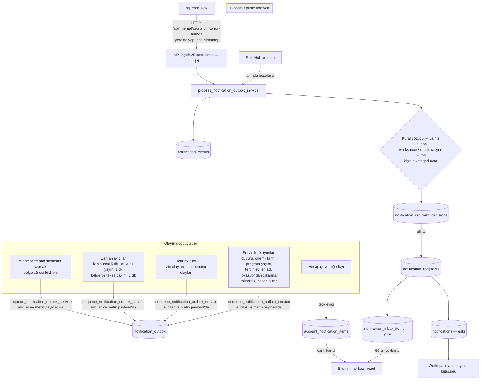

# BILDIRIM — bugünkü bildirim sisteminin incelemesi

Ölçüm: 2026-10-07, `origin/main` `b63c5150` (rapor yazılırken main `5bea59b8`; aradaki commit'ler yalnız belge). Salt okur: kod, yerel DB'de yalnız SELECT, Mert'in sunucusunda (5555) yalnız gezinme. Plan: [`tasks/BILDIRIM.md`](../tasks/BILDIRIM.md). Ekran görüntüleri: `artifacts/BILDIRIM/` (ana klasör, gitignore'da).

## Mert için özet

1. **Settings → Notifications bugün 29 kart ve 260'tan fazla kontrol gösteriyor; çoğu hiçbir şey değiştirmiyor.** Kanal (Email, Push) ve sıklık (Daily/Weekly digest) kaydediliyor ama gönderimde okunmuyor; yalnız "Enabled" kutusu gerçekten bildirimi kesiyor. 19 türün adı ham kod ("People.documents.activated").
2. **Tek kanal var: uygulama içi.** E-posta ve telefon bildirimi (push) kodu yok. Canlıda e-posta anahtarı da yok.
3. **Bildirim iki ayrı tabloya iki kez yazılıyor**; "okundu" yalnız birinde tutuluyor. Motor 18 tablo, 49 fonksiyon, 3 tetikleyici; 18 tablonun 5'i hiç yazılmıyor.
4. **Uygulamada 162 olay buldum; bugün 77'si mesaj üretiyor** (71'i uygulama içi bildirim, 6'sı yalnız e-posta). 85'i hiç üretmiyor. 18 yerde kural bildirim istiyor ama bildirim hiç ya da eksik gidiyor (ör. işten çıkarmada boşalan vardiya, programda vardiyası alınan kişi).
5. **Gürültü:** vardiya değişikliği owner'a ve bütün admin'lere de gidiyor (yerel ölçüm owner 138, admin 138, müdür 428 satır); belge incelemesi ortalama 4,6 kişiye; eksik belge hatırlatması her gün, sınırsız; bir karar aynı kişiye iki bildirim.
6. **Eksik:** karar verilince öteki karar vericilerin kutusundaki iş kalkmıyor; programda vardiyası alınan kişiye haber gitmiyor; "Onboarding complete" bildirimi hiç çalışmıyor.
7. **Güvenlik:** başvuru reddinin gerekçesi vardiyayı bırakan kişiye de gidiyor (koordinatöre bildirildi, BL-910). Kiracılar arası sızıntı yok.
8. **Yerelde bildirim kutusu dört rolde de boş:** kuyruğu işleyen zamanlayıcı yerelde çalışmıyor (1.537 bekleyen satır). Canlıda çalışıp çalışmadığı ölçülmedi.
9. Yeni sistemin planı ve sana 6 temel soru `tasks/BILDIRIM.md`'de; görsel varyantlar: https://claude.ai/artifact/M8yVRt1fWEY8Sg24ze8Wmv (kaynak `artifacts/BILDIRIM/bildirim-varyantlari.html`).

## 0. Nasıl ölçüldü

- Sekiz paralel salt okur alt ajan (hepsi Opus 5.5): veritabanı motoru, uygulama kodu, Schedule, Requests + Availability, Employees + Documents + katılım, Duyuru + Önemli tarih + Settings + Account + platform, rakipler, güvenlik (`nf-guvenlik`). Her raporun kilit iddiası bu oturumda elle doğrulandı (aşağıda ✓ işaretli olanlar dosyada okundu ya da SELECT ile ölçüldü). Bir iddia yanlış çıktı: "yerelde pg_cron yok" — var, ama işi yapan HTTP çağrısı yapılandırılmamış (§3.6).
- Ekran: Mert'in sunucusu (http://127.0.0.1:5555), dört rol. Owner, müdür, çalışan: Meyhouse fixture hesapları (`owner@newfork.test`, `test.manager@meyhouse.test`, `test.employee@meyhouse.test`, sihirli bağlantıyla). Admin: `test.admin@meyhouse.test` oturum açamadı (sign-in'de kalıyor, nedeni ölçülmedi); yerine e2e dünyası `World e2e1790265977849`'un admin'i (Zeynep). Masaüstü 1440, telefon 390; Playwright ile, uygulamaya veri girilmeden.
- Ayarı değiştirip etkisini ölçmek (§1.4): yerel DB kilidi (`db.lock`) bütün oturum boyunca başka oturumlardaydı; uygulamaya veri girilmedi. Etki, kod yolu satır satır izlenerek ve kayıtlı karar satırları (SELECT) okunarak ölçüldü.

## 1. Settings → Notifications (http://localhost:5555/app/settings/notifications)

### 1.1 Kim görüyor

| Rol | Ne oluyor (ölçüm) | Neden |
|---|---|---|
| Owner | Sayfa açılır, yazabilir | `notifications.settings.read/write` owner ve admin'de |
| Admin | Sayfa açılır, yazabilir | aynı |
| Müdür | Adres yazılınca kısa bir boş ekran, sonra sessizce Workspace'e döner; sol menüde Settings yok | müdürde `notifications.settings.*` yok (`schema.sql:4613-4618` `role_default_permissions`) |
| Çalışan | Sessizce Employee Hub'a döner | aynı |

Ekran görüntüleri: `owner-tall-app_settings_notifications-1440.png`, `admin-app_settings_notifications-1440.png`, `…-390.png`; müdür `manager-wait-app_settings_notifications-1440.png`.

### 1.2 Sayfada ne var

Başlık metni: "Choose which workspace updates are sent, who receives them, and which delivery channels are allowed. Personal preferences can only narrow these rules." (`apps/web/src/settings/NotificationSettingsPage.tsx:201`).

- Üstte: arama, "Category" listesi, "Policy scope" listesi (Organization + her rol + her lokasyon; Meyhouse'ta 1 + 4 + 4), "Reset reason" alanı, "Reset current category" ve "Reset all policies" düğmeleri.
- Altında 29 kart (yerel ölçüm, owner). Her kartta: başlık, açıklama, 3 etiket, "Enabled" kutusu, "Policy source / Audience / Requirement" satırı, "Allowed channels" (In-app, Email (not available yet), Push (not available yet)), "Cadence" (Immediate / Daily digest / Weekly digest), "Reason for <tür>" alanı, "Safe test", "Reset", "Save".
- En altta "Policy audit history".
- Sayım: 29 kart × 9 kontrol + 6 üst kontrol = **267 kontrol**; 29 tür × 9 kapsam = 261 ayrı kural yazılabiliyor.
- 19 kartın başlığı ham kod: "People.documents.activated", "Requests.time off.decided", "Schedule.time off.shifts opened"… (`NotificationSettingsPage.tsx:343,502-504` `humanLabel`; görünen adlar `packages/shared/src/notification-display.ts` yalnız 10 türü biliyor). BL-651 bunu 16 diye yazmıştı; bugün 19.

29 kart (owner ekranından, sırasıyla): New announcements · People.documents.activated · .approved · .assigned · .expiry · .missing · .rejected · .restored · .restricted · .review · Expiring employee documents · People.employee.no location · People.preferred name.approved · .published · .review required · Your availability updates · Employee availability changes · Shift change request updates · Shift change requests to review · Requests.time off.decided · .reminder · .review again · .shortened · Time-off request updates · Time-off requests to review · Schedule.important date.available · Published schedules · Schedule.time off.shifts opened · Cancelled employee invitations ("Always shown in app").

### 1.3 Her kontrol ne yapıyor

| Kontrol | Nereye yazılıyor | Gönderimde okunuyor mu | Sonuç |
|---|---|---|---|
| Enabled (Organization) | `notification_org_policies.enabled` (`schema.sql:21417`) | ✓ evet: `resolve_notification_policy_v1_service` (`:19543-19547`), çağıran `project_notification_recipients_service` (`:16819`) | **Etkili.** Kapatınca o türün yeni bildirimleri bütün workspace'te kesilir. Gönderilmiş olan kalır. Kişinin kendi ayarını da kilitler (`:15077-15085`). "Always shown in app" türlerde kapalı. |
| Enabled (rol kapsamı) | aynı tablo, `role_id` | ✓ `:19554-19558` | **Etkili**, o roldeki kişiler için. |
| Enabled (lokasyon kapsamı) | aynı tablo, `location_id` | yalnız olay lokasyon taşıyorsa (`:19560-19567`) | **Yarı etkili.** Duyuru, önemli tarih, program yayını ve vardiya değişikliği lokasyon taşıyor; izin, belge, müsaitlik, tercih edilen ad, lokasyonsuz kişi ve davet iptali taşımıyor → 29 türün 15'inde lokasyon kuralı kaydedilir ama hiç okunmaz. |
| Allowed channels | `.allowed_channels` | yalnız "in_app" sorulur (`:16819-16827`, sabit) | **Etkisiz.** Email ve Push her türde kapalı ("not available yet"); In-app son kalan kanal olduğu için kaldırılamıyor (`NotificationSettingsPage.tsx:392`). |
| Cadence | `.cadence` | karar satırına yazılır (`:16832`), sonra kimse okumaz ✓ | **Etkisiz.** Özet (digest) işi, tablosu ya da zamanlayıcısı yok. |
| Reason | `notification_audit_log.reason` | hayır | Zorunlu (en az 3 harf). Yalnız denetim geçmişinde görünür. |
| Save (kart başına) | sürüm kontrollü yazma | — | Pencerede 29 ayrı Save: ILKELER P20 "tek Save" kuralına aykırı. |
| Reset / Reset current category / Reset all policies | kural satırlarını **siler** (`:19300`) | — | Tek tık, geri alınamaz; CLAUDE.md §2.A.7 "yıkıcı iki tık kırmızı" kuralına aykırı (`NotificationSettingsPage.tsx:316-329,435-442`). |
| Safe test | `notification.policy.previewed` denetim satırı; dakikada 5 | — | **Hiçbir şey göndermez.** Yalnız düğmeye basan kişi için kuralı değerlendirip "allowed/denied" yazar (`schema.sql:15829-15890`). |
| Policy scope / Category / Search | ekran durumu | — | Arama ham tür kodunda da arar. |
| Policy audit history | son 50 kayıt | — | Ham eylem kodu yazar ("notification.policy.saved"). |

Kaydedilen ama hiç okunmayan sütunlar: `notification_org_policies.quiet_hours_policy`, `.mandatory_in_app`; `channel_defaults` okunur ama hiçbir ekran yazmaz.

### 1.4 "Ayarı değiştir, olayı tetikle, ne gitti" ölçümü

- **Uygulamada uçtan uca ölçülemedi:** yerel kuyruğu işleyen zamanlayıcı yerelde hiçbir yere istek atmıyor (`app_private.dispatch_cron_endpoint`, `schema.sql:2148-2180`: Vault'ta `app_api_url` / `cron_secret` yoksa çağrı yok; yerelde ikisi de yok). Sonuç: yerel `notification_outbox`'ta 2.420 satırın 1.537'si `pending` (en eskisi 2026-09-26); yalnız Shift Hub komutları kendi bildirimini anında işliyor (`apps/api/src/shift-exchanges/shift-exchanges-service.ts:100-130`). Bu yüzden Meyhouse ve e2e dünyasında dört rolün bildirim kutusu da boş (`owner-app_notifications-1440.png`, `admin-app_notifications-1440.png`).
- Kuyruğu elle boşaltmak 10'dan fazla oturumun paylaştığı DB'de başkalarının 1.537 satırını işlemek demek; yapılmadı.
- **Kayıtlı kararlar (SELECT):** `notification_recipient_decisions` 1.721 satır: 1.604 "allow" (hepsi `user_default`), 117 "deny" (hepsi `shift_exchange_audience_changed`). Yerelde hiç workspace kuralı (0) ve kişisel ayar (0) yok → bugüne kadar ne Settings ne Account ayarı tek bir bildirimi değiştirmiş.
- **Koddan kesin sonuç:** "Enabled" kapalı kural ya da kişinin "In app" kapatması projeksiyonda `deny` üretir, gelen kutusu satırı yazılmaz (`schema.sql:16853-16855`). Kanal ve sıklık hiçbir dalda okunmaz.

### 1.5 Sayfanın kurallarla çelişkisi

- ILKELER A "ayar cehennemi", P20 (tek Save, alan altında uzun açıklama yok), CLAUDE.md §2.A.7 (yıkıcı iki tık), §2.A.1 (web'de `permissions.includes` yasak: `NotificationSettingsPage.tsx:55-61`).
- KARARLAR:591 "Settings → Notifications: bildirim platformu ayrı proje olarak baştan" ve :574 "Settings → Notifications satırı … sayfa olduğu gibi kalır" — bu iş o "ayrı proje".
- GUVENLIK-A (KK-206): Settings → Roles'tan müdürün özel rolüne "Notifications: Edit" verilebiliyor; bu sayfanın 4 fonksiyonu yetki çekirdeği yerine eski `service_actor_has_permission` kapısından geçiyor (`schema.sql:11138, 15838, 19267, 21329`). KK-206 bu dört fonksiyonu BILDIRIM sökümüne bıraktı.

## 2. Öteki bildirim ekranları

### 2.1 Bildirim merkezi (sol menü → Notifications, `/app/notifications`)

- Herkes görür (menü öğesi yetki sormaz, `apps/web/src/shell/AppShell.tsx:268`). DOC-TABLE kararıyla (KARARLAR:575): Unread / Read sekmeleri, kategori listesi, çoklu seçim + "Mark as read", satırda çöp kutusu.
- Veri: iki sonsuz liste (Unread, Read); toplu "Mark as read" her satır için ayrı istek (BL-597); "Read (N)" sayısı yalnız yüklenen satırlardan (BL-596); çöp kutusu tek tık, ConfirmButton yok (BL-601); kategori listesinde hiç türü olmayan "Payroll" ve "System" var (`apps/web/src/views/NotificationsPage.tsx:82-92,336-349,438-447`).
- Rozet: sol menüde, dakikada bir yoklama (`AppShell.tsx:204-209`), "99+"; çalışan ana sayfasındaki zil "9+" (`employee-hub/DashboardCommunications.tsx:18-31`). İki ayrı sınır.
- Canlı güncelleme yok; yalnız hesap güvenliği bildirimleri ve Shift Hub canlı kanaldan gelir.
- Workspace ana sayfasındaki bildirim kutucuğu **eski** tablodan okuyor (BL-533; `schema.sql:12116-12119`), okundu bilgisi orada hiç değişmiyor.
- Telefonda (390) sütunlu tablo "Notification" tek sütuna iniyor, "0 selected" ile "Mark as read" iki satıra kırılıyor (`employee-app_notifications-390.png`).
- `/account/inbox` aynı sayfanın ikinci adresi; hiçbir menüde yok, yalnız bir e2e senaryosu açıyor.

### 2.2 Account → Notifications (`/account/preferences/notifications`)

- Herkes görür. Ekranda workspace seçici (birden çok workspace varsa) ve 5 kategori satırı: Schedule, Requests, People, Announcements, Workspace access alerts; her satırda "In app" ve "Email" kutusu, açılır ok; altta tek Save (P20'ye uygun).
- **In app kutusu etkili:** kapatan kişi o kategorideki yeni bildirimleri almaz (`schema.sql:19573-19605`). Karar bekleyen bildirim de kapatılabiliyor: müdür "Requests"i kapatırsa izin talepleri ona hiç gelmez, kimse fark etmez.
- **Email kutusu her zaman kapalı** (kilit nedeni sabit `delivery_unavailable`, `schema.sql:15024-15030`).
- Sayfa görünmeden sıklık, saat dilimi, sessiz saat ve "safe preview" değerlerini de gönderiyor; hiçbiri okunmuyor (`account/NotificationPreferencesPage.tsx:113-115`).
- API'nin döndürdüğü 6 hesap güvenliği türü sayfada hiç gösterilmiyor.
- Ekran görüntüleri: `owner-account_preferences_notifications-1440.png`, `employee-…-390.png`.

### 2.3 Çalışan tarafı (Employee Hub, telefon)

- Telefonda alt çubuk: Home, Schedule, Requests, More; Notifications "More" altında (`employee-hub/EmployeeMobileNav.tsx:79-105`).
- Ana sayfada "Latest updates" kutusu ve zil; bağlantı güvenlik süzgecinden geçmeden açılıyor (`DashboardCommunications.tsx:54`).

## 3. Bugünkü motorun haritası

### 3.1 Akış

### 3.2 Parçalar

| Parça | Nerede | Not |
|---|---|---|
| Kuyruğa yazma | `enqueue_notification_outbox_service` `schema.sql:9695` | Yalnız sabit olay kimliği verilirse tekrar korumalı; üreticilerin çoğu rastgele kimlik veriyor |
| İşçi | `apps/api/src/notifications/notification-outbox-worker.ts:70-175` (25'lik parti, 60 sn kira, 5 deneme) | Önce takas ve belge bakımını koşar |
| Zamanlayıcı | `pg_cron` `notification-outbox` her dakika → `dispatch_cron_endpoint` (`schema.sql:2148`; migration `20260918130000`) | ✓ yerelde 17.992 boş koşu |
| İşleme | `process_notification_outbox_service` `:16608` → `_before_signal` `:16515` | Etkileşime kapalı workspace atlanır (`:16540`) |
| Alıcı | Üretici `payload.recipient_user_ids` / `recipient_employee_ids` yazar; `project_notification_recipients_service` `:16774` kural çözücüden geçirir (`:16818-16829`) | Alıcı **üretici içinde** seçilir; her üretici kendi yolunu yazmış (§3.4) |
| Kural çözücü | `resolve_notification_policy_v1_service` `:19388` | Sıra: workspace kuralı → rol → lokasyon → kişinin tür/kategori ayarı → zorunlu tür. Satır içi kapsam mantığı (`:19476-19496`, `membership_location_scopes`) |
| Gelen kutusu | `project_notification_inbox_exchange_base` `:16680` → **iki tabloya yazar** (`:16716-16741`) ✓ | `public.notifications` (eski) + `notification_inbox_items` |
| Hesap bildirimleri | tetikleyici `project_account_security_notification` `:4455` (tetikleyici `:31095`) | Ayrı tablo, canlı kanal |
| Okuma | `get_notification_inbox_v2_service` (8 parametre) `:10973`; ölü ikizi 5 parametre `:10884` | Workspace kutusunda hesap güvenliği öğeleri de görünür (`:11036-11040`) |
| Okundu / sil | `act_on_notification_inbox_item_v2_service` `:6493` → `document_account_inbox_action_base` `:2183` → `act_on_notification_inbox_workspace_base` `:6525` | Yalnız yeni tablo; eski `notifications.read_at` hiç yazılmıyor ✓ (1.604 satır, 0 okunmuş) |
| Geri çekme | `communication_withdraw` `:2061` | Duyuru ve önemli tarihte kullanılıyor |
| Takas senkronu | `shift_exchange_sync_notifications` `:23991` | Eski metni günceller, eskiyenleri gizler |
| Canlı kanal | `account-notifications:<kişi>` (yalnız hesap öğeleri), `shift-exchanges:<ws>` (Shift Hub) | Workspace bildirimi için canlı kanal yok |
| Saklama | yok | `retention_class` hiçbir yerde okunmuyor; bütün tablolar sınırsız büyüyor |

### 3.3 Tablolar

| Tablo | Satır (yerel) | Durum |
|---|---|---|
| `notification_outbox` | 2.420 (1.537 bekliyor) | kuyruk |
| `notification_events` | 883 | |
| `notification_recipient_decisions` | 1.721 | `cadence` sütunu yazılır, okunmaz |
| `notification_recipients` | 1.604 | `auth.users`'a RESTRICT bağ: bildirim almış hesap kalıcı silinemez (`:32269`) |
| `notification_inbox_items` | 1.604 | yeni kutu |
| `notifications` | 1.604 | **eski kutu, ikiz** |
| `account_notification_items` | 46 | hesap güvenliği |
| `notification_catalog` | 35 | `packages/shared` kopyası 10 tür biliyor |
| `notification_template_versions` | 35 | yalnız hesap öğesi başlıkları |
| `notification_producer_registry` | 35 | bayat (takas türlerinin üreticisini yanlış yazıyor) |
| `notification_org_policies` | 0 | Settings sayfası |
| `notification_user_preferences` | 0 | Account sayfası |
| `notification_audit_log` | 876 | |
| `notification_consents`, `notification_endpoints`, `notification_delivery_attempts` | 0 / 0 / 0 | **hiç yazılmıyor** |
| `app_private.document_notification_dedup` | 143 | |
| `app_private.notification_legacy_default_accounts` | 0 | **hiç yazılmıyor** |

Ek: `employee_offboarding_followups` (işten çıkarma yazar, kimse okumaz); bildirim durumu taşıyan domain sütunları (`announcements.delivered_to`, `important_dates.delivered_to`, `schedule_time_off_requests.reminded_at/fallback_notified_at`, `employee_onboarding_cases.document_notification_checked_at/document_notified_restricted`, `shift_exchange_events.notification_sequence`).

### 3.4 Alıcı nasıl seçiliyor (üretici başına)

| Üretici | Tür | Alıcı yolu |
|---|---|---|
| `announcement_deliver` `:911` | duyuru | `communication_audience` → `communication_reaches` (`:1992-2012`): hedef kural + lokasyonun bütün müdürleri + owner + admin'ler ✓ |
| `important_date_deliver` `:3414`, `important_date_tell_removed` `:3638` | önemli tarih | aynı yol |
| `enqueue_document_notification` `:2871` | belge (9 tür) | inceleme: `authz_reason(…'documents.review')` (`:2884`); öteki: kişinin kendisi |
| `sync_expiring_document_todos_service` `:24699` | süresi dolan belge (yönetici) | **Workspace ana sayfası okunurken** yan etki (`:12106`) |
| `notify_schedule_request_event_service` `:15156` (tetikleyici) | izin talebi / kararı | `time_off_deciders` `:5284` |
| `time_off_notice` `:5538` ← `time_off_sweep` | hatırlatma, yeniden bak | oy veren / tek karar veren |
| `time_off_notify_shifts_opened` `:5560` | izin vardiya açtı | müdürler; admin ve owner hariç |
| `notify_time_off_shortened` `:15250` | izin kısaldı | **geçmişte onaylayanlar** (bugünkü yetki sorulmaz) |
| `publish_schedule_draft_service` `:17243` | program yayını | yayınlayanın "Notify" adımında seçtiği kişiler |
| `shift_exchange_emit_notification_base` `:23622` (16 çağıran) | vardiya değişikliği | katılımcılar; incelemeciler `schedule_actor_has_capability_service` (çekirdek dışı) |
| `weekly_preferences_save_service` `:27057` | müsaitlik | `availability.team_read` |
| `weekly_preference_settings_save_service` `:26889` | müsaitlik modu | employee rütbesindekiler |
| `remove_employee_from_location_service` `:18350` | lokasyonsuz kişi | `employee.terminate` |
| `request_employee_preferred_name_service` `:18883` | tercih edilen ad | `employee.decide_preferred_name` |
| `request_account_deletion_v2_service` `:18745` | davet iptali | `employee.invite` |

On bir ayrı alıcı yolu; üç ayrı yetki dili (`authz_reason`, `service_actor_has_permission`, `schedule_actor_has_capability_service`).

### 3.5 Kim neyi görür (RLS, yetki)

- Bildirim tablolarının 17'sinde RLS açık; anon ve authenticated'a tablo izni yok; tek istisna `account_notification_items` (yalnız kendi satırı, SELECT). Bildirim fonksiyonlarının hiçbiri tarayıcıya açık değil, hepsi API (`service_role`) üzerinden (`nf-guvenlik` ölçümü).
- Okuma kapısı: `authorize(…,'notifications.read_own')` + `recipient_user_id = kişi`. Okurken bildirimin konusuna yetki yeniden sorulmuyor: lokasyondan alınan müdür eski bildirimlerin başlık ve metnini okumaya devam ediyor (tıklayınca açılan sayfa ayrıca kontrol ediliyor).
- Settings ve Account uçlarında rota-yerel kapı ve tek biçimli olmayan "hayır" (`{error:"Workspace not found"}` 404 ya da çıplak 403; `communication-routes.ts:417-430`, `notification-settings-routes.ts:153-191`).
- Kural ihlalleri: 12 yasaklı adlı (`_base` / `_vN`) fonksiyonun 10'u bildirim fonksiyonu; `service_actor_has_permission` kullanan 10 fonksiyonun 4'ü bildirim; `auth.uid()`'i doğrudan kullanan politika `account_notification_self_read` (`:33151`).

### 3.6 Zamanlayıcılar (yerel `cron.job`) ✓

| İş | Sıklık | Bildirimle ilgisi |
|---|---|---|
| `notification-outbox` | her dakika | kuyruk + takas bakımı + belge bakımı (eksik belge, süre) |
| `announcements-due` | her dakika | zamanlanmış duyuru yayını, süresi dolanı geri çekme |
| `time-off-deadlines` | 5 dk | otomatik ret, hatırlatma, "yeniden bak" |
| `scheduled-exports` | 5 dk | haftalık program e-postası (Resend) |
| `account-deletion`, `workspace-retention` | günlük | hesap silme e-postaları; bildirim yok |

Yok: belge süresi zamanlayıcısı (ana sayfa açılınca üretiliyor), geçmiş önemli tarihi temizleme, bildirim saklama/silme, faturalama.

### 3.7 İkiz ve ölü yollar

- **İkiz depo:** her bildirim `notifications` + `notification_inbox_items` (✓ `:16716-16741`).
- **İkiz fonksiyonlar:** `get_notification_inbox_v2_service` iki imza (5 parametreli ölü), `act_on_…_v2` → `…_base` zinciri, `get_notification_user_preferences_service` → `_workspace_base`, `notification_user_channel_lock_reason_service` → `_workspace_base`, `process_…` → `_before_signal`, `project_notification_inbox_service` → `_exchange_base`, `shift_exchange_emit` → `_notification_base`, `project_schedule_notification_recipients_service`.
- **Ölü tablo:** `notification_consents`, `notification_endpoints`, `notification_delivery_attempts`, `notification_legacy_default_accounts`; yazılır-okunmaz: `employee_offboarding_followups`.
- **Ölü sütun:** `notification_events.supersedes_event_id`; politikada `quiet_hours_policy`, `mandatory_in_app`; kişisel ayarda `quiet_hours`, `timezone`, `safe_preview_enabled`; katalogda `dedupe_policy`, `retention_class`, `template_key`, `audience_contract`.
- **Ölü izinler:** `notifications.delivery_audit.read`, `.dlq.replay`, `.broadcast.approve` (owner/admin'e verilmiş, hiçbir yerde sorulmuyor); `notifications.preferences.write_own` sorulmuyor; yetki çekirdeğindeki `settings.notifications.read/write` eylemleri kullanılmıyor.
- **Ölü üretici:** "Onboarding complete" (`people.documents.activated`) ✓ — tetikleyici `onboarding_events`'te `employee.activated` bekliyor (`:4174-4177`), o tabloya hiç yazılmıyor (yerel: 0; etkinleştirme `employee.auto_activated` 2.077 kez başka tabloya).
- **Ölü web:** yayın toast'ı "N employees notified" hiç görünmüyor ✓ (web `notification_count` okuyor, DB `notification_enqueued_count` döndürüyor: `schema.sql:17262-17264`, `SchedulePage.tsx:3173-3176`); `seen` ve `read_all` eylemleri hiç gönderilmiyor; üç ayrı elle yazılmış istek sarmalayıcısı; `packages/shared` katalog dosyaları yalnız kendi testince kullanılıyor.
- **Katalog kayması:** veritabanında 35 tür, `packages/shared`'de 10.

## 4. Olay envanteri

**162 olay; bugün 77'si mesaj üretiyor** (71'i uygulama içi bildirim, 6'sı yalnız e-posta), **85'i üretmiyor**. Alanlar arası tekrarlar tek sayıldı (ör. izin vardiya açtı yalnız Requests'te, işten çıkarma yalnız Employees'te). "Bugün" sütununda ✗ = mesaj yok.

| Alan | Olay | Bugün mesaj | Eksik (kural istiyor, yok) | Gürültü riski yüksek |
|---|---|---|---|---|
| Schedule | 22 | 5 | 4 | 1 |
| Requests + Availability | 41 | 35 | 3 | 4 |
| Employees + Documents + katılım | 47 | 18 | 6 | 3 |
| Duyuru + Önemli tarih + Settings + Account + üyelik + platform + faturalama | 52 | 19 | 5 | 2 |
| **Toplam** | **162** | **77** | **18** | **10** |

Kısaltmalar: **K:** = `KARARLAR.md` satırı; **S:** = `schema.sql` satırı; **Ö** = önerilen alıcı (ILKELER P07: karar veren + işi doğrudan etkilenen; admin gürültüsü yok, Mert'in açık istisnaları korunur).

### 4.1 Schedule (22)

| # | Olay | Tetikleyen → etkilenen | Bugün | Kural | Ö | Gürültü |
|---|---|---|---|---|---|---|
| SCH-01 | Düzenleme kilidi başkasında | düzenleyen → öteki düzenleyen | ✗ (ekranda ad) | K:472 | yok | — |
| SCH-02 | Kilit düşünce "Auto-save" taslağı | sonraki → önceki | ✗ | KK-162 K:517 "bildirim yok" ✓ | yok | — |
| SCH-03 | Hareketsizlikte otomatik taslak | sistem | ✗ | K:508 ✓ | yok | — |
| SCH-04 | Taslakta vardiya ekle/değiştir/sil, yapıştır | düzenleyen | ✗ (canlı kanal) | K16 "taslak söz değildir" ✓ | yok | — |
| SCH-05 | Şablon, otomatik doldurma, geri al | düzenleyen | ✗ | ✓ | yok | — |
| SCH-06 | Taslak / şablon kaydet, sil | düzenleyen | ✗ | ✓ | yok | — |
| SCH-07 | Kapalı gün taslağa düşer | yazar | ✗ | K16 ✓ | yok | — |
| SCH-08 | Taslak açıkken başkası yayınlar | başka yayınlayan | ✗ (yayın penceresinde uyarı satırı) | K:473 ✓ | yok | — |
| SCH-09 | Hafta yayını (ilk) | yayınlayan → vardiyalı çalışanlar | ✓ `schedule.published`, S:17243; "Notify" adımında yayınlayanın seçtikleri; içeriksiz metin "week of 2026-10-12" | kural yok (K:175 "baştan tasarlanacak") | vardiyası olanlar, otomatik | düşük |
| SCH-10 | Yeniden yayın: saat/gün/iş/not değişti | yayınlayan → değişen kişi | ✓ aynı tür; her seferinde yeni, içeriksiz satır; birleştirme kuralı kayıtlı ama okunmuyor (S:28224) | yok | değişen kişi, tek satırda birleşik | **orta-yüksek** |
| SCH-11 | Yeniden yayın: vardiya Ali → Bob | yayınlayan → Ali, Bob | kısmi: Bob ✓, **Ali ✗** (S:16288-16295 ✓) | yok | Ali + Bob | düşük |
| SCH-12 | Yeniden yayın: vardiya açığa alındı | yayınlayan → Ali | **✗** (S:16295) | yok | Ali | düşük |
| SCH-13 | Yeniden yayın: vardiya silindi | yayınlayan → Ali | kısmi: listede görünür, başka vardiyası yoksa düşer (S:17228-17236) | yok | Ali | düşük |
| SCH-14 | Açık vardiyayla yayın | yayınlayan → uygun çalışanlar | ✗ (yalnız Shift Hub listesi) | yok | → Soru 6 | yüksek (yayılırsa) |
| SCH-15 | Yumuşak uyarının üstüne yayın | yayınlayan | ✗ | K:451 ✓ | yok | — |
| SCH-16 | Yayın reddedildi | yayınlayan | ✗ (ekranda hata) | ✓ | yok | — |
| SCH-17 | Başlamış vardiyayı düzenleme | düzenleyen → atanan | çelişki: uyarı "Employees will not be notified" (S:21994), sonraki yayın yine bildirebilir | yok | atanan (değişirse) | düşük |
| SCH-18 | Yayından kaldırma | yayınlayan → haftadakiler | **✗**; eski bildirim kutuda kalır, boş haftaya götürür | yok | vardiyası olanlar ("removed") | düşük |
| SCH-19 | Başka lokasyonda planlanan çok lokasyonlu kişi (ghost) | öteki müdür | ✗ | K:428 | yayında SCH-09 yeter | — |
| SCH-20 | "Vardiyan yaklaşıyor" hatırlatması | sistem → atanan | yok (özellik yok) | yok | MVP dışı önerisi | orta |
| SCH-21 | "Bu hafta yayınlanmadı" hatırlatması | sistem → müdür | yok | yok | MVP dışı önerisi | orta |
| SCH-22 | Zamanlanmış haftalık program e-postası | kural sahibi → adresler | ✓ e-posta (Resend; canlıda anahtar yok) | K:418, :521, :526 | kural sahibinin seçtiği | düşük |

### 4.2 Requests + Availability (41)

İzin (17):

| # | Olay | Bugün | Kural | Ö | Gürültü |
|---|---|---|---|---|---|
| T01 | İzin talebi | ✓ `requests.time_off.submitted` S:15188 → karar verenler (ort. 5,9, en çok 14) | K:124-127 | karar verenler ✓ | düşük-orta |
| T02 | Owner'ın kendi izni (onaysız) | kısmi: yalnız "vardiya açıldı" müdürlere; alıcısız boş kuyruk satırı | K:75 ✓ | vardiyası açılan lokasyon müdürleri | düşük |
| T03 | Çok lokasyonda kısmi oy ("waiting: Beşiktaş") | ✗ | K:124, :126 ✓ | yok | — |
| T04 | Son onay | ✓ çalışana **sonucu söylemeyen** "Time-off request updated"; öteki karar verenlere "Time off approved"; + T05 | K:124, :130 | çalışana sonuçlu tek; ötekilerin açık işi kapanır | **orta** (aynı müdüre iki) |
| T05 | Onaylı izin vardiya açtı | ✓ `schedule.time_off.shifts_opened` S:5599 → müdürler (admin/owner hariç; müdür yoksa kimse) | K:130 | T04'e katılır; müdürsüz lokasyonda admin/owner | orta |
| T06 | Ret | ✓ çalışana genel metin + ötekilere "declined" | K:124 | çalışan + açık işi kapanır | düşük |
| T07 | Çalışan geri çekti | ✓ karar verenlere; "withdrawn" ile "revoked" aynı başlık | K:126 | karar verenlerin işi kapanır | düşük |
| T08 | Yönetici iptal etti (revoke) | ✓; bekleyen iptal talebi varsa iki çift bildirim (S:20452-20457) | K:126 | çalışan, tek | orta |
| T09 | Süre doldu, otomatik ret | ✓ | K:126 | çalışan + işi kapanır | düşük |
| T10 | Sistem otomatik onay (lokasyon düştü) | ✓ T04 + T05 | K:124, :125 | T04 gibi | orta |
| T11 | Son karara 12 saat | ✓ `requests.time_off.reminder` S:5892, bir kez | K:126 ✓ | onaylamayan lokasyonun müdürleri | düşük |
| T12 | "Admin bekliyor" | ✓ S:5866, bir kez; T11 ile tek satır | K:125, :131 ✓ | admin/owner | düşük |
| T13 | Etki değişti, oy sıfırlandı | ✓ `review_again` S:5843 | K:130 ✓ | o müdür | düşük |
| T14 | Onaylı iznin iptal talebi | ✓ T01 yolu | K:126 ✓ | karar verenler | düşük |
| T15 | İptal talebi karara bağlandı | ✓ ama onayda iki kez (S:5430) | K:126 | çalışan + işi kapanır, tek | orta |
| T16 | Müdür izni kısalttı | ✓ yalnız son onaylayana + çalışana; "is back on the schedule" metni (BL-396) | K:166 | çalışan + bütün onaylayanlar | düşük |
| T17 | Çalışan izinli gününde vardiya aldı | ✓ `shortened`; tek lokasyonda onaylayan çoğu zaman aynı kişi → kimseye | K:166 ✓ | izni onaylayan | düşük |

Vardiya değişikliği (takas, cover, pickup) (16):

| # | Olay | Bugün | Kural | Ö | Gürültü |
|---|---|---|---|---|---|
| S01 | Takas teklifi | ✓ arkadaşa | K:169 ✓ | arkadaş | düşük |
| S02 | İsimle cover isteği | ✓ arkadaşa | K:169 ✓ | arkadaş | düşük |
| S03 | Havuza cover açıldı | ✓ **her uygun çalışana ayrı** (ort. 5,2, en çok 11) | **kural yok** | → Soru 6 | **yüksek** |
| S04 | Arkadaş kabul etti | ✓ sahibe + **incelemecilere: owner, bütün admin'ler, öteki müdürler** (owner 138, admin 138, müdür 428) | **KK-158 K:552 ✗** | sahip + karar verecek lokasyon müdürü; müdür yoksa admin/owner | **yüksek** |
| S05 | Arkadaş reddetti | ✓ sahibe | — | sahip | düşük |
| S06 | Bırakılan vardiyaya başvuru | ✓ sahip + geniş incelemeci (ort. 7,3) | K:552 ✗ | sahip + karar veren müdür | orta-yüksek |
| S07 | Açık vardiyaya başvuru | ✓ incelemecilere | K:552 | lokasyon müdürü | orta |
| S08 | Başvuran geri çekti | kısmi | — | sahip | düşük |
| S09 | Müdür başvuruyu reddetti | ✓ başvurana **ve sahibe, gerekçeyle** (BL-910) | K:548 | başvuran (gerekçeyle) + sahip (genel metin) | düşük |
| S10 | İki lokasyonlu takasta ilk onay | ✓; her basışta yeniden (R2-18) | K:552 | öteki lokasyonun müdürü | orta |
| S11 | Son onay | ✓ kişiye göre metin; kaybedenlere "Another teammate was selected" | K:169 ✓ | katılımcılar | orta |
| S12 | Arama kapatıldı | ✓ | — | katılımcılar | düşük |
| S13 | Süre doldu (vardiya başladı) | ✓ | — | katılımcılar | düşük |
| S14 | Bekleyen talepte müdür vardiyayı değiştirdi | ✓ "Existing acceptances remain valid"; çakışan kabul **hiç düşmüyor** | **K:170 ✗** | katılımcılar + karar veren | orta |
| S15 | Vaka geçersiz (vardiya değişti, kapalı gün, izin) | ✓ | K14 benzeri | katılımcılar, tek | düşük |
| S16 | Owner'ın kendi takası | ✓ | K:546 ✓ | karar veren müdür (admin yedek) | düşük |

Müsaitlik (8):

| # | Olay | Bugün | Kural | Ö | Gürültü |
|---|---|---|---|---|---|
| A01 | Çalışan haftasını kaydetti | ✓ `availability.weekly_updated` → müdürler + admin'ler + owner (ort. 4,9, en çok 16) | **K:72 (Mert, 2026-09-26: rütbe şartı yok)** ✓ | K:72 korunur | **yüksek** |
| A02 | Değişiklik olmadan kaydetti | ✓ yine bildirim | EKRAN-04 K3 / BL-790 ✗ | yok | orta |
| A03 | Owner müsaitlik modunu değiştirdi | ✓ bütün çalışanlara (davetliler dahil); haftası olmayana da "converted" | M4 K:140 ✓ / BL-793 ✗ | bütün çalışanlar, doğru metinle | orta (tek sefer) |
| A04 | "Availability onboarding required" anahtarı | ✗ | — | yok | — |
| A05 | Müsaitlik bekleyen istekle çakıştı | ✗ | M5 K:141 ✓ | yok | — |
| A06 | Terfide müsaitlik silindi | ✗ | M14 K:150 ✓ | yok | — |
| A07 | Yönetici notu | ✗ | — | yok | — |
| A08 | Vardiya tipinin saati değişti, işaretler kaydı | ✗ | EKRAN-04 S3 açık | — | düşük |

### 4.3 Employees + Documents + katılım (47)

| # | Olay | Bugün | Kural | Ö | Gürültü |
|---|---|---|---|---|---|
| J01 | Davet gönderildi | ✓ **e-posta** (Resend; canlıda yok); workspace ve davet edenin adı yok | K:246 | davetli | düşük |
| J02 | Davet hatırlatması / yeniden gönder | kısmi: yalnız teslim başarısızsa | K:375 ✗ | davetli | düşük |
| J03 | Davet geri alındı | ✗ | — | yok | — |
| J04 | Davetli hesabını sildi → davet iptal | ✓ davet edenlere; metin hesap silmeyi açıklıyor (gizlilik) | — | davet eden, genel metin | düşük |
| J05 | Davet süresi doldu | ✗ (durum tembel değişir) | — | davet eden (soru değil, öneri) | düşük |
| J06 | Davet kabul edildi | ✗ | — | yok | — |
| J07 | Davet reddedildi | ✗ | — | davet eden | düşük |
| J08 | Kayıt e-postası doğrulama | ✓ Supabase e-postası | — | kişi | — |
| O01 | Onboarding başladı | ✗ | — | yok | — |
| O02 | Onboarding incelemeye gönderildi | **✗** | K:100, K:175 | lokasyon müdürü; yoksa admin/owner | orta |
| O03 | Adım onaylandı | ✗ | — | O06'ya katılır | — |
| O04 | Adımda düzeltme istendi | **✗** | — | çalışan (gerekçe yalnız uygulamada) | düşük |
| O05 | Resmî ad düzeltme önerisi | **✗** | K:90 | owner + admin'ler (alt rütbe için) | düşük |
| O06 | Onboarding tamamlandı | **ölü üretici** | — | çalışan | düşük |
| O07 | Bekleyen onboarding'den ayrıldı | ✗ | — | davet eden (bilgi) | düşük |
| N01 | Tercih edilen ad istendi | ✓ owner + admin'ler + müdürler; ilk karardan sonra ötekilerde kalır | K5 (Mert 2026-10-06) ✓ | K5 korunur, karar verilince kapanır | orta |
| N02 | Tercih edilen ad otomatik yayın | ✓ aynı kişilere | K:272 ✓ | K:272 | orta-yüksek |
| N03 | Tercih edilen ad onaylandı | ✓ çalışana | K:273 ✓ | çalışan | düşük |
| N04 | Reddedildi / yenisiyle değişti | ✗ | K:273 ✓ (sessiz) | yok | — |
| N05 | Resmî ad doğrudan değişti | ✗ | K11 | çalışan (bilgi) | düşük |
| N06 | Profili yönetici düzenledi | ✗ | — | yok | — |
| N07 | Rol değişti / terfi | ✗ | M14 | kişi (bilgi) | düşük |
| N08 | Lokasyon eklendi | ✗ | — | yok | — |
| N09 | Bir lokasyondan çıkarıldı (öteki kaldı) | ✗; gelecekteki vardiyaları sessizce açılır | K:79, :410 | vardiya açıldıysa o lokasyonun öteki müdürü | düşük |
| N10 | Son lokasyondan çıkarıldı | ✓ işten çıkarabilenlere (owner 1, admin 5 yerel); metin "End their employment" ama ekran izin vermiyor (BL-765) | K:79 ✓ | K:79 | düşük-orta |
| N11 | Uygulama erişimi kaldırıldı | ✗ | — | yok | — |
| N12 | Tamamen işten çıkarma | **✗**; takip satırı yazılır, kimse okumaz | **KK-174 K:369 ✗** | boşalan yayınlanmış vardiyanın lokasyon müdürü | düşük |
| N13 | Arşiv | ✗ | — | N12 gibi | — |
| N14 | Geri alma (Restore) | **✗** | **K:374 / S1 satır 10 ✗** | dönen kişi (e-posta + uygulama), lokasyon müdürü | düşük |
| N15 | Sahiplik devri başladı | ✗ (yalnız Account sayacı) | — | hedef kişi | düşük |
| N16 | Devir kabul / ret / iptal / süre | ✗ | — | karşı taraf | düşük |
| N17 | Üye ayrıldı | yok (özellik yok) | — | — | — |
| D01 | Kural yeni belge istedi | ✗ hemen; ertesi sabah 09:00 "missing" | K:96-100 | çalışan, toplu tek | orta |
| D02 | "Ask for a document" | özellik yok (BL-554) | K:98 | çalışan; isteyenin adı yok | düşük |
| D03 | İstek yeniden açıldı | ✓ | — | çalışan | düşük |
| D04 | Muafiyet / süre uzatma | ✗ | K:97 | çalışan (uzatmada) | düşük |
| D05 | Belge yüklendi, inceleme bekliyor | ✓ bütün karar verenlere (ort. 4,6); ilk karardan sonra ötekilerde kalır | K:91-93 | → Soru 3 | **yüksek** |
| D06 | Belge incelemesiz kabul | ✓ **yükleyen kişinin kendisine** | — | yok | orta |
| D07 | Belge onaylandı | ✓ çalışan | — | çalışan | düşük |
| D08 | Belge reddedildi | ✓ çalışan, genel metin (gerekçe yok, doğru) | K:91 | çalışan | düşük |
| D09 | Eksik / gecikmiş belge | ✓ **her gün 09:00, sınırsız** (BL-823) | yok | çalışan, sınırlı (ör. son tarihten 7 ve 1 gün önce, gününde) | **yüksek** |
| D10 | Süre yaklaşıyor (çalışan) | ✓ 30/7/1 gün, ayarı yok sayıyor (BL-822) | — | çalışan | düşük |
| D11 | Süre yaklaşıyor / doldu (yönetici) | ✓ ama **yalnız biri Workspace'i açınca**; "expired" hiç gitmiyor (BL-806) | araştırma T1 | karar verenler | orta |
| D12 | Kişi kısıtlandı | ✓ çalışan; başlık D09 ile aynı | K:87 | çalışan | düşük |
| D13 | Erişim geri geldi | ✓ çalışan | K:87 | çalışan | düşük |
| D14 | Politika imzalandı / geri çekildi | ✗ | — | yok | — |
| D15 | Belge türü yayından kalktı / arşiv | ✗ | K:604 | yok | — |

### 4.4 Duyuru, önemli tarih, Settings, Account, üyelik, platform, faturalama (52)

| # | Olay | Bugün | Kural | Ö | Gürültü |
|---|---|---|---|---|---|
| C01 | Duyuru yayını | ✓ hedef + **lokasyon müdürleri + owner + admin'ler** (✓ `communication_reaches`); yayınlayan ≠ yazar ise yayınlayan kendi bildirimini alır | **K5 ters çevrildi + K24 ✗**, KK-89 | yalnız hedef listesi, yayınlayan hariç | **yüksek** (BL-858) |
| C02 | Zamanlanmış yayın | ✓ aynı; yayın anında yetki sorulmuyor (BL-859) | K22 | C01 gibi | — |
| C03 | Zamanlanmış yayın başarısız | **✗** | **K21 ✗** | yalnız yazar | düşük |
| C04 | Yayındaki duyurunun içeriği değişti | ✓ herkese, onaylar sorulmadan silinir | **K27 ✗** (BL-861) | "kalsın"da onaylamamışlar, "sıfırlansın"da herkes | yüksek |
| C05 | Yalnız saat değişti | ✗ ✓ | K4(4) | yok | — |
| C06 | Hedef değişti | ✓ yalnız yeni eklenenler | K4(2) ✓ | yeniler | düşük |
| C07 | Unpublish | ✗ (kutudan çekilir) | K8 ✓ | yok | — |
| C08 | Yeniden yayın | ✓ onaylamamışlara | K27 (sorulmalı) | K27 | orta |
| C09 | Archive | ✗ | K8 ✓ | yok | — |
| C10 | Restore | ✗ | K8 ✓ | yok | — |
| C11 | Süre doldu | ✗ (kutudan çekilir) ✓ | K12 ✓ | yok | — |
| C12 | Süresi dolmuşun bitişi uzatıldı | ✓ **onaylamış olanlara da** | K12 eki ✗ (BL-867) | onaylamamışlar | orta |
| C13 | Okundu onayı | ✗; zildeki satır okunmamış kalır | K22, K23 | yok | — |
| C14 | Remind | **özellik yok** | **K23 ✗** | "Not yet" kişiler | orta |
| I01 | Önemli tarih oluşturuldu | ✓ lokasyondaki herkes + müdürler + owner + admin'ler, yazar hariç | K5 (tarihte sürüyor), K7 ✓ | K5 | orta |
| I02 | İçerik değişti | ✓ herkese yeniden; değiştiren kendi bildirimini alır, yazar almaz (BL-890) | K7 | K7, değiştiren hariç | orta |
| I03 | Lokasyon eklendi | ✓ yenilere | K7 ✓ | yeniler | düşük |
| I04 | Kapalı gün yayınlanmış vardiyayı düşürdü | ✓ K14 tek bildirim; bekleyen takas varsa **ikinci** bildirim | K13, K14 ✓ | kişiye tek; müdüre "N vardiya açık" yok | orta |
| I05 | Unpublish | ✗; **K14 "shift removed" bildirimi de geri çekiliyor** (BL-883) | K8, K15, P09 | K14 bildirimi kalır | — |
| I06 | Yeniden yayın | ✓ açmamışlara | K7 ✓ | aynı | düşük |
| I07 | Archive | ✗; K14 de çekilir | K8 | K14 kalır | — |
| I08 | Restore | ✗ | K8 ✓ | yok | — |
| I09 | Tarih geçti / yıllık tekrar | ✗; geçmiş bildirim zilde süresiz | yok | tarih geçince kutudan çekilir (öneri) | düşük |
| W01 | Müsaitlik modu değişti | → A03 | | | |
| W02 | Öteki program ayarları | ✗ | — | yok | — |
| W03 | Lokasyon arşivlendi | ✗ doğrudan; dolaylı belge yeniden kontrolü | — | owner + admin (lokasyonsuz kalan varsa) | düşük |
| W04 | İş / departman değişti | ✗; duyuru hedefini sessizce değiştirir | — | yok | — |
| W05 | İmzalanacak politika yayınlandı | dolaylı (09:00 "missing") | — | istenen kişiler | düşük |
| W06 | Workspace adı / saat dilimi değişti | ✗ | — | yok (saat dilimi: müdürler, soru değil) | — |
| W07 | Rol izni / üye rolü değişti | ✗ | M14 | kişi | düşük |
| H01 | Parola değişti | ✓ **iki satır**: password_changed + sessions_revoked | — | kişi, tek; e-posta da | orta |
| H02 | "Forgot password" ile sıfırlama | **✗ (olay yok)** — başkası yaptıysa fark edilmez | — | kişi (e-posta) | — |
| H03 | E-posta değişikliği istendi | ✓ + Supabase doğrulama e-postaları | — | kişi | düşük |
| H04 | E-posta değişikliği iptal | ✓ | — | kişi | düşük |
| H05 | E-posta değişikliği tamamlandı | ✗ | — | kişi (iki adres) | — |
| H06 | Öteki oturumları kapat | ✓ | — | kişi | düşük |
| H07 | Yeni cihazdan giriş | ✗ (bilerek reddedilmiş tür) | — | kişi (e-posta), MVP sonrası | orta |
| H08 | Hesap silme istendi (+ 7. gün ve son 24 saat) | ✓ uygulama içi (ama hesap anında kapandığı için görülmüyor) + kurtarma e-postası | — | kişi (e-posta) | düşük |
| H09 | Hesap silme tamamlandı | ✗ | — | — | — |
| H10 | Hesap silme geri alındı | ✓ | — | kişi | düşük |
| H11 | E-posta değişikliği doğrulama e-postası | ✓ Supabase | — | kişi | — |
| H12 | Parola sıfırlama bağlantısı | ✓ e-posta (Resend; canlıda yok) | — | kişi | — |
| M01 | Workspace kapanışı planlandı / anında / iptal | ✗ | — | bütün üyeler (e-posta) | — |
| M02 | Saklama silmesi tamamlandı | ✗ | — | yok | — |
| M03 | Zamanlanmış dışa aktarma 3 hatadan sonra kapandı | ✗ | — | kuralın sahibi | düşük |
| B01 | Deneme süresi bitiyor (3 gün kala) | özellik yok (Stripe) | — | owner | — |
| B02 | Deneme bitti, kart yok | — | — | owner + admin | — |
| B03 | Ödeme başarısız | — | — | owner | — |
| B04 | Ödeme için doğrulama gerekiyor (SCA) | — | — | owner | — |
| B05 | Fatura ödendi | — | — | owner, yalnız e-posta | — |
| B06 | Abonelik gecikti / kilitlendi / dönem sonunda iptal | — | — | owner + admin; kilitlenince herkes | — |
| B07 | Fatura kesilemedi (adres) | — | — | owner | — |
| B08 | Faturalama sahibi değişti (devir) | — | — | eski ve yeni owner | — |
| P01 | Belge süresi işi (yönetici) | → D11 | | | |
| P02 | Hesap silme hatırlatma e-postaları | → H08 | | | |

(W01, P01, P02 başka satırın tekrarıdır; sayıma girmedi. Tabloda 55 satır, 52 olay.)

### 4.5 Kurallarla çelişen ve eksik olanlar (özet)

1. **Fazla kişiye gidiyor:** vardiya değişikliği incelemesi (KK-158; BL-731), duyuru (K24; BL-858), belge incelemesi ve tercih edilen ad ilk karardan sonra ötekilerde kalıyor, eksik belge her gün (BL-823), değişiklik olmadan müsaitlik kaydı (BL-790), cover yayılımı (kural yok).
2. **Bir olay iki bildirim:** izin onayı + "vardiya açıldı" (BL-730), iptal onayı (S:5430), revoke + bekleyen iptal, parola değişti + oturumlar kapandı, kapalı gün + takas geçersiz.
3. **Gitmesi gereken yere gitmiyor:** vardiyası alınan / açığa alınan / silinen kişi (SCH-11–13), yayından kaldırma, işten çıkarmada boşalan vardiya (KK-174; BL-768), Restore (K:374), zamanlanmış duyuru hatası (K21), Remind (K23), onboarding incelemesi ve resmî ad önerisi (K:90, K:100), izin kısaltmada bütün onaylayanlar (BL-736), müdürsüz lokasyonda "vardiya açıldı".
4. **Metin:** izin kararı sonucu söylemiyor (BL-738), "is back on the schedule" (BL-396), yayın "week of 2026-10-12", 19 ham tür adı, aynı başlık iki anlam ("Documents need attention", "withdrawn/revoked").
5. **Geri çekme hatası:** K14 "shift removed" bildirimi kapalı gün geri alınınca kutudan siliniyor (BL-883, P09).

## 5. Güvenlik ve gizlilik

| # | Ciddiyet | Bulgu | Kanıt | Yeni sistemde |
|---|---|---|---|---|
| G1 | 🔴 yüksek | Başvuru reddinin gerekçesi vardiyayı bırakan kişiye de gidiyor | S:24196, :23632, :23634-23637 ✓; Shift Hub okuması gerekçeyi sahipten gizliyor (S:24349). `task/ekran-02-a4` aynı kodu taşıyor ✓ | Koordinatöre bildirildi (2026-10-07 08:46Z), **BL-910** açıldı. Serbest metin yalnız yazıldığı kişiye |
| G2 | 🟠 orta | Okurken yetki yeniden sorulmuyor; lokasyondan alınan / rütbesi düşen müdür eski bildirim metinlerini okumaya devam ediyor | S:10973-11040 | Okuma süzgeci ya da yetki kaybında geri çekme |
| G3 | 🟠 orta | "İzin kısaldı" alıcısı = geçmişte onaylayanlar; bugünkü yetki sorulmuyor | S:15266-15271 | Alıcı yalnız yetki çekirdeğinden |
| G4 | 🟠 orta | Rota-yerel kapı, `permissions.includes`, tek biçimli olmayan "hayır" | §3.5 | `authorize()` + 42501/`authz.*` |
| G5 | 🟠 orta | Yetki matrisi API'nin kullanmadığı ölü ikiz fonksiyonu sınıyor | `authorization_matrix.test.sql:529` → S:10884 | Tek imza, matriste gerçek çağrı |
| G6 | 🟢 düşük | `auth.uid()` doğrudan (S:33151); satır içi kapsam (S:19480-19496); lokasyon boşsa her lokasyon yeter (S:23655) | | Hepsi çekirdekten |
| G7 | 🟢 düşük | Workspace'te "hepsini okundu yap" hesap güvenliği öğelerini de okundu yapar | S:2192-2199 | Hesap ve workspace ayrı |
| G8 | 🟢 düşük | `shift-exchanges:<ws>` yayını bütün workspace'e kimlik numarası taşıyor | S:3334, 5712, 24253 | Kişiye özel sinyal |
| G9 | 🟢 düşük | Saklama yok; adlar ve saatler süresiz | — | Türüne göre silme işi |
| G10 | 🟢 düşük | Davet iptal metni hesap silmeyi açıklıyor; tercih edilen ad bildirimleri tam ad taşıyor; belge süresi işi belge izni olmayana tam ad + belge adı gösteriyor (BL-807) | S:18748-18752, :18897-18899, :12148-12153 | Genel metin |
| G11 | 🟢 düşük | Zamanlayıcı sırrı sabit sürede karşılaştırılmıyor | `notification-outbox-routes.ts:22` | `timingSafeEqual` |

Sağlam olanlar: kiracılar arası yol yok; RLS açık, tarayıcıya fonksiyon açık değil; canlı kanallar private; belge bildirimleri genel metinli, ret gerekçesi yok.

## 6. Bildirime dokunan bütün kod

**SİL** = yalnız bildirim için var, yeni sistemde silinir. **DÜZENLE** = bildirimi çağırır, yeni sisteme bağlanır. Satır sayısı `wc -l`, bütün dosya.

| Paket | SİL | DÜZENLE |
|---|---|---|
| apps/api | 7 dosya / 1.575 satır | 17 dosya / 11.994 |
| apps/web | 17 dosya / 3.332 | 43 dosya / 37.196 |
| packages/shared | 5 dosya / 1.510 | 6 dosya / 40.204 (33.941'i üretilen yetki matrisi dökümü) |
| packages/ui | 0 | 0 (`Toaster.tsx:26` yalnız "Notifications" etiketi) |
| e2e | 0 | 5 dosya / 1.056 |
| supabase/tests (pgTAP) | 11 dosya / 1.569 | 36 dosya / ~10.700 (47 / 172 dosya bildirime değiyor) |
| supabase/schema.sql | 18 tablo, 49 fonksiyon, 3 tetikleyici, 1 tür, 2 politika, 1 zamanlayıcı | ~30 domain fonksiyonu (üretici çağrısı) |
| supabase/migrations | geçmiş, dokunulmaz (437'nin 106'sı bildirime değiyor) | yeni söküm + kurulum migration'ı |

**apps/api — SİL:** `notifications/notification-outbox-routes.ts` 42 · `notification-outbox-worker.ts` 196 + test 252 · `notification-settings-routes.ts` 201 + test 513 · `notification-settings-service.ts` 139 + test 232.
**apps/api — DÜZENLE:** `app.ts` 1180 + `app.test.ts` 3665 · `communications/communication-routes.ts` 439 + test 466 · `communication-service.ts` 293 + test 285 · `account/account-security-routes.ts` 247 + test 317 · `account-security-service.ts` 394 + test 332 · `shift-exchanges/shift-exchanges-service.ts` 143 + test 147 · `schedule/schedule-routes.ts` 1462 · `schedule-service.ts` 1375 + test 1042 · `route-error-contract.test.ts` 112 · `service-error-contract.test.ts` 95. Korunur: `email/resend-email.ts` 56 + test 112.

**apps/web — SİL:** `views/NotificationsPage.tsx` 452 · `communications/NotificationShiftDetails.tsx` 203 + test 337 + `notification-shift-details.css` 127 · `communications/use-account-notification-realtime.ts` 18 · `documents/DocumentNotificationRedirect.tsx` 18 + test 22 · `account/NotificationPreferencesPage.tsx` 225 + test 313 · `notification-preferences-data.ts` 55 + test 88 · `notification-preferences.css` 215 · `settings/NotificationSettingsPage.tsx` 512 + test 334 · `notification-settings-data.ts` 87 + test 74 · `notification-settings.css` 252.
**apps/web — DÜZENLE:** `App.tsx` 596 + test 6245 · `shell/AppShell.tsx` 527 + `AppShellNotificationBadge.test.tsx` 476 · `communications/communications-data.ts` 228 + test 106 · `action-url.ts` 17 + test 22 · `employee-hub/DashboardCommunications.tsx` 128 · `EmployeeDashboard.tsx` 483 · `EmployeeMobileNav.tsx` 131 · `shift-exchanges/exchange-data.ts` 160 · `views/WorkspacePage.tsx` 653 + test 447 · `AnnouncementsPage.tsx` 1066 · `SchedulePage.tsx` 3588 · `ScheduleRequestsPage.tsx` 869 + test 474 · `CommunicationPages.test.tsx` 649 · `EmployeeHubPage.test.tsx` 859 · `MainNavigationHeaderContract.test.ts` 83 · `list-page.css` 365 · `account/AccountLayout.tsx` 139 · `settings/SettingsLayout.tsx` 170 · `SettingsHomeRedirect.tsx` 27 · `NotificationSettingsNavigation.test.tsx` 231 · `SettingsPageAlignment.test.ts` 90 · `auth/PermissionRoute.tsx` 61 · `tenant-query-cache.ts` 51 · `schedule/components/PublishScheduleDialog.tsx` 1046 + test 1030 · `schedule-data.ts` 797 · `styles.css` (~170 bildirim satırı: 9160-9270, 13410-13442, 13841-13985, 14014) · `lib/refusal-reaches-screens.test.ts` 70 · `shell/AppSidebarPanel.test.tsx` 67 · `EmployeeViewSwitch.test.tsx` 100 · `ManagementMobileNav.test.tsx` 170 · `dev/FeedbackGalleryPage.tsx` 497 · `dev/feedback-catalog.ts` 74.

**packages/shared — SİL:** `notification-catalog.ts` 426 + test 226 · `notification-display.ts` 287 · `notification-settings.ts` 315 + test 256. **DÜZENLE:** `index.ts` 3194 + test 2028 · `communications.ts` 304 · `authorization.ts` 428 · `role-permissions.ts` 309 · `authorization-matrix.expected.json` (üretilir).

**e2e — DÜZENLE:** `flows/announcement-reaches-its-people.spec.ts` 124 · `schedule-availability-warning.spec.ts` 426 · `shift-hub-time-off.spec.ts` 78 · `employee-onboarding.spec.ts` 242 · `time-off-approval.spec.ts` 186. Bildirim ekranlarını açan hiçbir senaryo yok.

**supabase/tests — SİL (yalnız bildirim):** `notification_platform_core` 309 · `notification_outbox_relay` 231 · `notification_preference_resolver_and_producers` 201 · `notification_settings_admin` 174 · `notification_user_preferences` 146 · `bl052_document_notifications` 96 · `notification_schedule_publish_atomic` 90 · `shift_exchange_immediate_inbox` 89 · `bl052_document_account_inbox` 84 · `account_notification_scope` 69 · `live_updates_are_private` 80 (yalnız bildirim konusu çıkar, dosya kalır). **DÜZENLE (üretici sınayan):** `shift_exchanges_v1` 453 · `communication_operations` 190 · `authorization_coverage` 324 · `retired_objects_stay_gone` 469 · `announcements_and_dates_edge_cases` 442 · `time_off_opens_shifts` 110 · `weekly_exchange_changed_terms` 205 · `past_dates_and_ended_announcements` 297 · `time_off_shortens_for_a_shift` 204 · `preferred_name_approval` 305 · ve 26 hafif dokunan dosya (`closed_days_reach_the_shifts`, `time_off_voting`, `authorization_matrix`, `authz_catalog`, `workspace_rls` …).

### 6.1 `retired_objects_stay_gone`'a girecek nesneler

Testte bugün zaten olanlar: `time_tracking.%`, `availability.review_required`, `schedule.staffing.%`, `schedule.owner_time_off.shifts_opened` türleri; `lineup_notification_outbox`; `act_on_notification_service`, `heartbeat_notification_outbox_service`, `resolve_notification_in_app_policy_v1_service`, `save_notification_user_preference_service`, `create_schedule_publish_notifications_service`, Line Up bildirim fonksiyonları, `availability_notify`, `*_legacy_notifications`, `notify_owner_time_off_open_shifts`, `synchronize_announcement_notification_lifecycle_service`.

Eklenecekler:

- **Tablolar (18):** `notification_outbox`, `notification_events`, `notification_recipient_decisions`, `notification_recipients`, `notification_inbox_items`, `account_notification_items`, `notification_catalog`, `notification_template_versions`, `notification_producer_registry`, `notification_org_policies`, `notification_user_preferences`, `notification_consents`, `notification_endpoints`, `notification_delivery_attempts`, `notification_audit_log`, `app_private.document_notification_dedup`, `app_private.notification_legacy_default_accounts`; eski şekliyle `public.notifications` (yeni sistem aynı adı farklı şekille kullanırsa test sütun şeklini sınar). Ayrıca `employee_offboarding_followups` (yeni sistemde KK-174 bildirimi bunun yerine geçer).
- **Tür:** `notification_category`. **İndeksler:** `notification_outbox_staffing_delivery`, `notifications_staffing_subject`.
- **Fonksiyonlar (49):** `enqueue_/lease_/fail_/process_notification_outbox_service`, `process_notification_outbox_before_signal`, `project_notification_event_service`, `project_notification_recipients_service`, `project_schedule_notification_recipients_service`, `project_notification_inbox_service`, `project_notification_inbox_exchange_base`, `flush_shift_exchange_notifications_service`, `resolve_notification_policy_v1_service`, `notification_default_channels_service`, `notification_user_channel_lock_reason_service` + `_workspace_base`, `notification_user_preference_to_json`, `notification_actor_is_active_member_service`, `get_notification_inbox_v2_service` (iki imza), `get_notifications_service`, `act_on_notification_inbox_item_v2_service`, `act_on_notification_inbox_workspace_base`, `get_notification_settings_service`, `save_notification_policy_service`, `reset_notification_policies_service`, `preview_notification_policy_service`, `get_notification_user_preferences_service` + `_workspace_base`, `save_notification_user_preferences_service`, `reconcile_notification_platform_service`, `record_account_security_notification_service`, `shift_exchange_notification_allowed`, `shift_exchange_notification_policy_service`, `shift_exchange_sync_notifications`, `shift_exchange_emit_notification_base`, `notify_schedule_request_event_service`, `notify_time_off_shortened`; `app_private.`: `announcement_deliver`, `important_date_deliver`, `communication_withdraw`, `document_account_inbox_action_base`, `document_account_inbox_allowed`, `document_notification_policy`, `enqueue_document_notification`, `document_notify_access`, `notify_document_audit`, `project_account_security_notification`, `time_off_notice`, `time_off_notify_shifts_opened`.
- **Tetikleyiciler (3):** `project_account_security_notification`, `document_notification_audit`, `notify_time_off_event`.
- **Politika / yayın:** `account_notification_self_read`; Realtime "people hear their own account notifications"; `account_notification_items`'ın `supabase_realtime` üyeliği.
- **Zamanlayıcı:** `notification-outbox` işi.
- **İzinler:** `notifications.settings.read`, `.settings.write`, `.test_send`, `.delivery_audit.read`, `.dlq.replay`, `.broadcast.approve`; çekirdek eylemleri `settings.notifications.read/write`. (Kalacaklar plana göre: `notifications.read_own`, `notifications.preferences.write_own`.)

## 7. Paralel işlerle bağ

| İş | Bağ | Plan nasıl karşılıyor |
|---|---|---|
| **EKRAN-02 veri paketi** `task/ekran-02-a1a2` (`1a1b26cc`, ONAY @`945d8df7`) | Takas incelemecileri lokasyon başına `app_private.exchange_decision_reason` ile (müdür; müdür yoksa admin/owner; owner/başvuran/yapan hariç) — KK-158'i kapatır; aynı lokasyon onayına tekrar basınca bildirim yok (R2-18); çakışan kabul düşer + "invalidated" bildirimi (K:170) | Yeni sistemin "karar veren" kitlesi bu fonksiyonun **genelleştirilmiş hâli** olur (`notification_deciders`); EKRAN-02 önce main'e girer, BILDIRIM onun üstüne kurulur. Tür anahtarı değişmiyor, o yüzden çakışma yalnız `shift_exchange_emit_notification_base` gövdesinde: BILDIRIM üreticiyi `notify()`'a bağlarken a1a2'nin alıcı kuralını aynen taşır. |
| `task/ekran-02-a3` (`e1061c7c`, ONAY @`4b6a6369`) | "Tek karar tek bildirim" (R2-13): onay + vardiya açıldı tek; iptal ve revoke çiftleri kalkar; sonuç başlıkta (R2-45); kısaltmada bütün onaylayanlar (R2-23); "is no longer time off" | Yeni sistemde bu kural **genel kural** olur: aynı konu + aynı alıcı + aynı karar → tek satır (grup anahtarı) ve karar bekleyen satırın "kapandı"ya dönmesi. a3'ün `time_off_opened_shifts_told` yardımcısı söküm listesine girer. |
| `task/ekran-02-a4` (`c0a5e701`) | Bildirim kodu yok; ama `shift_exchange_emit_notification_base`'i aynı sızıntıyla yeniden yazıyor | BL-910 EKRAN-02'de düzelmezse BILDIRIM'in B2 diliminde kapanır; kırmızı test her iki durumda yazılır. |
| EKRAN-02 açık kalanlar | BL-200 (takas onayında 2 sn bekleme), R2-09 / BL-740 (bildirimden kapalı izin açılmıyor) | Senkron yazma (plan §Model) BL-200'ü kendiliğinden kaldırır; bağlantılar `?request=` ile tek biçim. |
| **GUVENLIK-A** (KK-206) | GA-3 bildirim ayarı rotasını ve 4 fonksiyonunu (`get_notification_settings`, `save_notification_policy`, `reset_notification_policies`, `preview_notification_policy`) **BILDIRIM sökümüne bıraktı**; müdür rolüne "Notifications: Edit" verilebilmesi (GA-2) | Settings → Notifications kalkarsa (Soru 2-a) dört fonksiyon ve iki izin silinir; GA-2'nin Roles ekranındaki "Notifications" satırı da kalkar. BL-556 (`notification_actor_is_active_member_service`) söküme girer. |
| **EKRAN-08 Important Dates** | K14 bildiriminin geri çekilmesi (BL-883), değiştiren kişinin kendi bildirimi (BL-890), çekmecede "Remove" | Önemli tarih üreticisi B3 diliminde `notify()`'a bağlanır; kurallar: K14 bildirimi kalıcı, alıcıdan işi yapan çıkar. EKRAN-08 çekmece işi bildirim koduna dokunmamalı (dosya çakışmasın). |
| **EKRAN-10 Settings** | Settings menüsünde Notifications öğesi; Roles ekranındaki "Notifications" izinleri; General/Locations/Jobs hatlarında ortak öğeler | Soru 2'nin cevabına göre Settings menüsü (`SettingsLayout.tsx:42-47`) ve `SettingsHomeRedirect.tsx` değişir; EKRAN-10 hatları bu dosyalara dokunuyorsa sıra koordinatörde. |
| EKRAN-07 Announcements | K24, K27, K21, K23, K12 eki (BL-858, 861, 864, 867) | Teslim kuralları (kime, ne zaman) B3'te; "onaylar kalsın / sıfırlansın" penceresi ve Remind düğmesi EKRAN-07 ekranının işi, BILDIRIM yalnız `notify()` çağrısını verir. |
| EKRAN-03 Employees | KK-174 işten çıkarma bildirimi (BL-768), Restore S1 bildirimleri, BL-765 | B4'te. |
| EKRAN-04 Availability | BL-790, BL-793 | B2'de. |
| EKRAN-05 Workspace | Ana sayfa kutucuğu eski tablodan (BL-533), ölü sayaç (BL-816), belge süresi işi ana sayfa açılınca üretiliyor (BL-806) | B4 (günlük iş) + B7 (kutucuk yeni okumaya). |
| EKRAN-06 Documents | BL-806, 807, 822, 823 | B4. |

## 8. Rakipler (yalnız referans; okuma 2026-10-07)

| | 7shifts | Homebase | When I Work | Deputy |
|---|---|---|---|---|
| Kanal | Push > e-posta > SMS (kısa liste); uygulama içi merkez | e-posta, push, SMS | e-posta ya da "Mobile" (uygulama açıksa push, değilse SMS; günde 20 SMS) | zil her zaman; uygulamada değilse push yerine e-posta; SMS ücretli, kapalı gelir |
| Ayar | kişi başına tür × kanal matrisi (~40 tür); şirket: "Only with shifts", vardiya hatırlatması | herkes kendi ayarını yapar ("Managers cannot edit notification preferences for their employees") | kişi başına uyarı × {Email, Mobile} | çoğu kurum/lokasyon ayarı; "Shift notifications recipient" (en alttaki yetkili müdür) |
| Karar bildirimi | izin doğrudan müdüre; müdür yoksa admin | — | yöneticiye istek, çalışana karar | izin yalnız seçilen onaylayana; en alttaki müdür, üstlere gitmez |
| Yayın | — | yayınlayan kime gideceğini seçer | "Notify users with changes" / "Notify all users" | "Publish updates" / "Publish all" / "Mark as published (not notified)" |
| Özet / sessiz saat | haftalık özet e-postası (yalnız admin); sessiz saat yok | yok | yok | yok |
| Merkez | zil; 3 ay geçmiş; e-postalar listede yok | doğrulanmadı | "Things Needing Your Action" (üzerine gelince onayla) / "Awaiting others" / "Notifications" | zil + "Me" ekranı |
| Şikâyet | teslim güvenilmez | okunmuş rozet silinmiyor | "overwhelming" / "didn't come through" | "too many notifications" |

Kaynaklar: kb.7shifts.com/hc/en-us/articles/29771113662099, 4417519530771, 4417519795347, 38259689187603, 4417513783827, 4417513581971, 48276402521619 · support.joinhomebase.com/s/article/Editing-Alerts-and-Notifications (2025-08-01), Editing-Notification-Preferences (2025-07-24), Alerts-and-Notifications (2026-06-19), Step-3-Adding-Editing-Shifts-in-the-Schedule · help.wheniwork.com/articles/setting-your-alert-preferences/ (2025-08-06), publishing-the-schedule-computer/, viewing-notifications-computer/ · help.deputy.com/hc/en-au/articles/9368598155919, 4692803698063, 4688746992399, 4692822425999. Not: `help.homebase.ai` başka bir şirket (akıllı kilit), Homebase değil.

Çıkarım: (1) karar bildirimi tek kişiye, yoksa yedeğe (7shifts, Deputy) — P07 ile aynı; (2) yayında "yalnız değişenlere" varsayılanı (When I Work, Deputy); (3) "karar bekleyenler" akıştan ayrı (When I Work); (4) tür × kanal matrisi ve 11 ayrı takas olayı gibi bölünmeler gürültü ve ayar yükü; (5) şikâyetlerin yarısı güvenilirlik (kaçan bildirim, silinmeyen rozet): az göndermek kadar doğru okundu durumu önemli.

## 9. Açık backlog bağı

Plan şu açık maddeleri kapatır ya da yerini alır (her biri dilim numarasıyla `tasks/BILDIRIM.md`'de): BL-045, BL-046, BL-055 (bildirimde tarih biçimi), BL-200, BL-258, BL-348, BL-396, BL-533, BL-539, BL-556, BL-596, BL-597, BL-601, BL-614, BL-651, BL-730, BL-731, BL-736, BL-738, BL-740, BL-768, BL-776, BL-790, BL-793, BL-806, BL-807, BL-816, BL-822, BL-823, BL-858 (teslim kısmı), BL-864 (yazar bildirimi), BL-867, BL-883, BL-890, BL-910 (EKRAN-02'de kapanmazsa). Kısmen: BL-599 (telefon liste), BL-661, BL-787 (sayfalama), BL-898 (bildirim rotaları).

## 10. Ölçülmeyenler

- Canlıda kuyruk işleniyor mu, kaç bekleyen / ölü satır var (canlı DB'ye bu işte dokunulmadı).
- Uçtan uca "ayar → olay → bildirim" uygulamada (yerel kuyruk çalışmıyor; §1.4).
- `test.admin@meyhouse.test` neden oturum açamıyor.
- SCH-13 ve SCH-17'nin uçtan uca davranışı (koddan okundu).
- Cover adaylarının lokasyon/iş bağı (`weekly_exchange_candidate_check`).
- Canlı Supabase SMTP ayarı.
